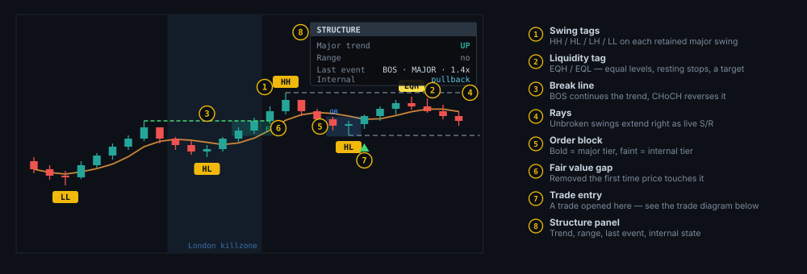
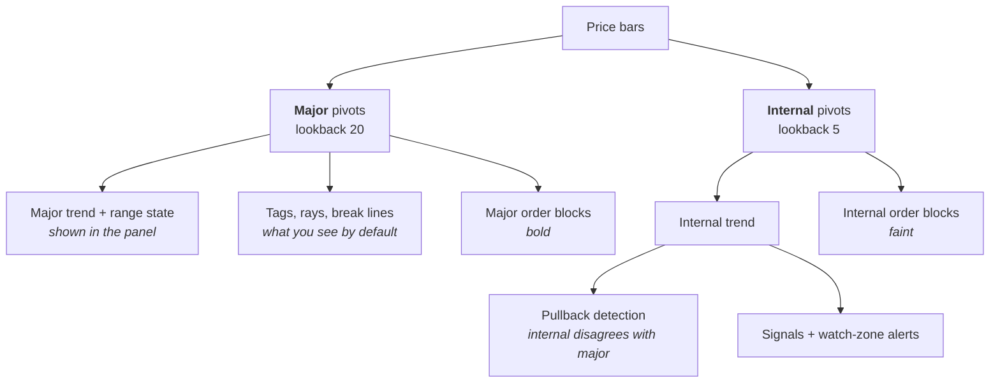
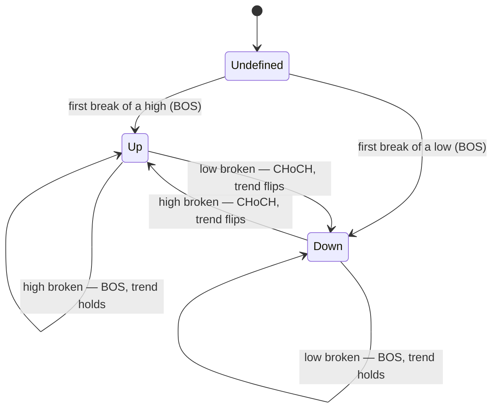
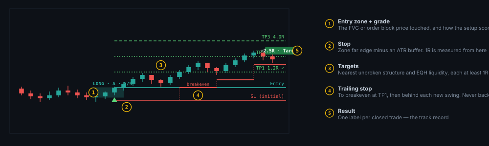
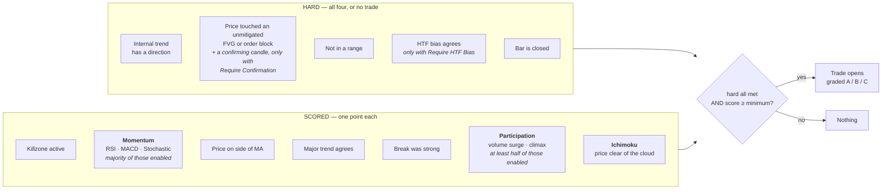
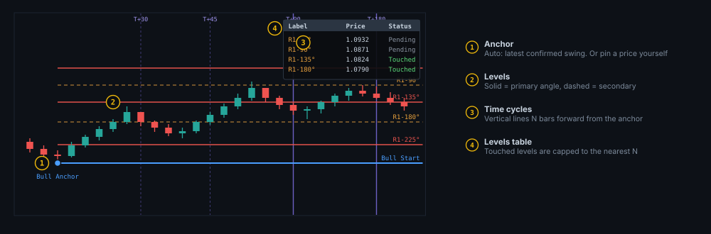

🌐 [Read this in English](README.md)

# مؤشرات TradingView

ثلاثة مؤشرات Pine Script v6 لمنصة TradingView، مكتوبة ليُقرأ محتواها بقدر ما تُستخدَم. كل منها ملف واحد
مستقل بذاته — بلا مكتبات، بلا مصدر بيانات غير ما تقدمه TradingView نفسها، لا شيء يحتاج تثبيتًا سوى لصق
السكربت في TradingView.

| السكربت | ماذا يفعل | اللوحة |
|---|---|---|
| [`src/ict-rsi-ma-indicator.pine`](src/ict-rsi-ma-indicator.pine) | يرصد بنية السوق (Market Structure)، الـ Order Blocks، الـ Fair Value Gaps، وجلسات الـ Killzone، ثم يقيّم كل ذلك في صفقات مُصنَّفة بدرجة (Grade) مع منطقة دخول، وقف خسارة، أهداف، ووقف متحرك | على الرسم البياني للسعر |
| [`src/gann-angles.pine`](src/gann-angles.pine) | مستويات غان السعرية (ثلاثة أنماط) مُسقَطة من نقطة ارتكاز تلقائية أو يدوية، بالإضافة إلى دورات غان الزمنية | على الرسم البياني للسعر |
| [`src/egx-trust-indicator.pine`](src/egx-trust-indicator.pine) | دخول شراء فقط (long only) على أسهم البورصة المصرية بعد ارتداد، تحكمه حالة اتجاه EGX30 أو EGX70. كل دخول يحمل درجة ثقة (Trust Score)، وسجلًا متراكمًا لأداء كل فئة درجة، ووقف خسارة، وهدفًا أول، ووقفًا متحركًا، مع لوحة نتائج مقسومة إلى فترة ضبط (Tuning) وفترة اختبار (Test) | على الرسم البياني للسعر |

المؤشرات مستقلة تمامًا. شغّل أيًا منها بمفرده، أو عدة مؤشرات معًا. تحدّد TradingView عدد المؤشرات
التي يمكن أن يحملها الرسم الواحد في الباقات الأدنى، فتحقق من باقتك قبل تشغيل الثلاثة معًا.

---

## التثبيت

1. افتح رسمًا بيانيًا على [tradingview.com](https://www.tradingview.com).
2. افتح **Pine Editor** (اللوحة السفلية).
3. افتح ملف الـ `.pine` من هذا المستودع، انسخ محتواه كاملًا، والصقه في المحرر بدلًا من أي محتوى موجود.
4. اضغط **Add to chart**.
5. للاحتفاظ به: اضغط **Save**، أعطه اسمًا، وسيظهر تحت *Indicators → My scripts*.

تصل إلى الإعدادات من خلال أيقونة الترس (gear) بجانب اسم المؤشر على الرسم البياني.

---

# ICT + RSI/MA Confluence

## الفكرة

يميل السعر إلى الانعكاس عند المستويات التي غادرها بسرعة، وهذه الانعكاسات تستحق الأخذ بها **فقط عندما
تتفق عدة عوامل مستقلة في آن واحد**. هذا المؤشر يجد هذه المستويات، يتتبع الاتجاه البنيوي للسوق، ويحدد
الشموع التي تتوافق فيها كل هذه العوامل.

المؤشر لا يخبرك أبدًا بالشراء. هو يحدد شمعة توافقت فيها عدة شروط مستقلة، يقيّم عددها، ويترك القرار لك.

## قراءة الرسم البياني



### المصطلحات

معظم هذه المصطلحات مأخوذة من تداول "Smart Money Concepts". تبدو كمصطلحات متخصصة لكن كل واحد منها
يعبّر عن فكرة بسيطة:

| المصطلح | ماذا يعني فعليًا |
|---|---|
| **Swing high / low** | شمعة أعلى (أو أقل) من عدد محدد من الشموع على جانبيها |
| **HH / HL / LH / LL** | Higher High، Higher Low، Lower High، Lower Low — كيف تُقارَن قمة/قاع بالتي قبلها على نفس الجانب |
| **EQH / EQL** | Equal High / Equal Low. قمتان أو قاعان عند سعر شبه متطابق. أوامر وقف الخسارة تتكدس بالقرب منها، لذا يُجذَب السعر إليها غالبًا |
| **BOS** | Break of Structure — كسر البنية. أغلق السعر متجاوزًا نقطة swing **في اتجاه الترند القائم بالفعل** — استمرارية |
| **CHoCH** | Change of Character — تغيّر الطابع. أغلق السعر متجاوزًا نقطة swing **عكس** الترند — هذا ما يقلب الاتجاه |
| **Order block** | آخر شمعة معاكسة اللون قبل كسر بنيوي. غالبًا ما تتم زيارتها مجددًا قبل أن يواصل السعر تحركه |
| **FVG** | Fair Value Gap: نمط من ثلاث شموع تتحرك فيه الشمعة الوسطى بسرعة كبيرة بحيث تترك فجوة سعرية. يعود السعر لملئها كثيرًا |
| **Killzone** | نافذة زمنية تكون فيها إحدى الجلسات الرئيسية نشطة (لندن، نيويورك، وآسيا اختياريًا). تتركز فيها السيولة |

## كيف يعمل محرك البنية (Structure Engine)

يُرصَد الـ swing على **مستويين في آن واحد**، لأن إعدادًا واحدًا لا يمكنه أداء الوظيفتين معًا. المدى
القصير (lookback) يلتقط كل تذبذب صغير — مفيد لتوقيت الدخول، عديم الجدوى لقراءة الترند. المدى الطويل
يقرأ الترند بوضوح لكنه يُخفي كل مستوى قد تتداول عليه فعليًا.



> *ملاحظة: المخطط أعلاه ورد بالإنجليزية كما هو في الكود، تجنبًا لأي مشاكل عرض في Mermaid عند خلط
> النصوص العربية بعلامات HTML الداخلية.*

كلا المستويين يشغّل نفس خط المعالجة (pipeline) بشكل مستقل. اللوحة تعرض المستوى الرئيسي (Major)،
بينما محرك الإشارات يقرأ حاليًا المستوى الداخلي (Internal).

### BOS مقابل CHoCH — آلة حالة الترند

الترند لا يتغيّر إلا عند حدوث **CHoCH**. أما الـ BOS فيؤكد الترند الموجود بالفعل.



لا يُسجَّل الكسر إلا عندما تغلق شمعة **مغلقة** متجاوزةً المستوى. الفتيل (wick) العابر للمستوى لا يُعدّ
كسرًا، فلا يظهر شيء ثم يختفي فجأة.

كل كسر يسجّل أيضًا مدى قوته — جسم الشمعة الكاسرة مقسومًا على الـ ATR — بحيث يمكن التمييز بين كسر
مقنع وآخر ضعيف بدلًا من تجاهل هذا الفارق بصمت.

### حالة النطاق (Range)

الترند ليس القصة كاملة: قد يكون السوق "صاعدًا" من الناحية الفنية بينما لا يذهب إلى أي مكان، وهنا
تُحدِث إشارات متابعة الترند أكبر ضرر. لذا تُرفَع علامة **Range** منفصلة عندما تقع آخر قمتين رئيسيتين
وآخر قاعين رئيسيين جميعًا داخل نطاق ضيق (افتراضيًا 2.5 × ATR) **و** تكون هذه القمم/القيعان الأربع
حديثة (افتراضيًا خلال 100 شمعة).

الشرط الثاني مهم — فبدونه يمكن لأربع نقاط swing متناثرة عبر مئات الشموع أن تقع صدفةً داخل نطاق ضيق
وتُقرأ كتجميع (consolidation) رغم أن شيئًا من هذا لم يحدث فعليًا.

> **النطاق (Range) هو فيتو صارم.** لا تُفتَح أي صفقة أثناء قراءته `YES`، مهما بدا الإعداد جيدًا — هذا
> هو الهدف من تتبعه. كما يُعرَض في اللوحة حتى تطبّق حكمك الخاص على كل شيء آخر في الرسم البياني.

### لوحة البنية (Structure Panel)

| الصف | المعنى |
|---|---|
| **Major trend** | `UP`، أو `DOWN`، أو `—` قبل أول كسر |
| **Range** | `YES` عندما تكون البنية في حالة انضغاط — تعامل مع إشارات الترند بحذر |
| **Last event** | آخر كسر: نوعه، وأي مستوى (tier)، وقوته بوحدات الـ ATR (مثال: `BOS · MAJOR · 1.4x`) |
| **Internal** | `aligned` عندما يتفق المستويان؛ `pullback` عندما يتحرك المستوى الصغير عكس المستوى الكبير — غالبًا ما يكون هذا هو الإعداد المطلوب |

## محرك الصفقات (Trade Engine)

المثلث لم يعد يعني فقط "توافقت الشروط" — بل يعني **فتح صفقة فعلية**، بمنطقة دخول، وقف خسارة، ثلاثة
أهداف، ووقف يتحرك (trailing stop). صفقة واحدة تعمل في كل مرة؛ وطالما هي مفتوحة، تُتجاهل أي إعدادات
جديدة تظهر.



### كيف يتأهل الإعداد (Setup)

نوعان مختلفان من الشروط، والفرق بينهما مهم:



الشروط الأربعة الصارمة (HARD) مطلقة، لأنه بدونها لا يوجد شيء يمكن حسابه — لا اتجاه يعني لا جانب
(long/short)، ولا منطقة تعني لا سعر دخول ولا وقف خسارة.

**ثلاثة فلاتر تداول اختيارية** تقف إلى جانب هذه الشروط، معطّلة افتراضيًا جميعًا (**Trade Filters** في
الإعدادات). `Require HTF Bias` يضيف شرطًا صارمًا خامسًا: يجب أن تتفق الصفقة مع البنية على فريم زمني
أعلى، تُقرأ من آخر شمعة مغلقة على ذلك الفريم حتى لا تُعيد كتابة التاريخ (repaint) أبدًا. `Require
Displacement` يعمل قبل ذلك — يمنع تكوّن المناطق الضعيفة من الأساس، فأي فجوة أو order block لم ينتج
عن شمعة اندفاع حقيقية لا يُرسَم ولا يُتداوَل أبدًا. `Require Confirmation` يغيّر *توقيت* احتساب اللمسة:
بدلًا من التداول على شمعة اللمسة نفسها، يتذكّر اللمسة وينتظر حتى `Confirmation Max Wait` شمعة لشمعة
تُغلق في اتجاه الصفقة، مستخدمًا منطقة ووقف اللمسة الأصلية طوال الوقت. هذه فلاتر لا نقاط تقييم، عن قصد:
اتجاه الدرجة (score) لم يثبت اتساقه عبر الرموز، فهذه الفلاتر تقرر أي الإعدادات موجودة أصلًا بدلًا من
إضافة أصوات لها.

**Require HTF Bias و Require Displacement: اختُبرا، ولم يتحسّن الأداء بإعداداتهما الافتراضية.** عبر
عشرة رسوم بيانية (أربعة يومية من EGX؛ ETH وSOL وXRP على 4H و1H)، رفع كل فلتر متوسط R على أربعة رسوم
فقط، وكل إعداد مُفلتَر كان أسوأ من عدم استخدام أي فلتر عند تجميع الرسوم معًا. ساعدا الحالات الضعيفة
أصلًا وأضرّا بالقوية. اتركهما معطّلين إلا إذا كنت تختبرهما على رمزك الخاص. القراءات الكاملة في
`docs/superpowers/plans/2026-09-17-htf-displacement-filter-validation.md`.

**Require Confirmation موجود بسبب ما استبعده هذان الاختباران.** تسجيل كل صفقة مُغلَقة (`Log Closed
Trades`، أدناه) وقراءتها لاحقًا أظهر أنه على رمزين مستقلَّين، أكثر من نصف الصفقات لم تصل قط إلى 1R
لصالحها قبل أن تفشل — منجرفة ضد المركز لعدة شموع بدلًا من الفشل فورًا، وهو توقيع لمسة تُطلَق قبل أن
يبدأ الانعكاس فعليًا. لا `Require HTF Bias` (الذي يفحص الاتجاه) ولا `Require Displacement` (الذي يفحص
تكوّن المنطقة) يلامس هذه الآلية؛ `Require Confirmation` يستهدفها مباشرة. البيانات الكاملة في
`docs/superpowers/plans/2026-09-17-trade-log-root-cause-diagnosis.md`.

**اختُبر، وانقسمت نتيجته بوضوح حسب السوق.** عبر نفس الرسوم العشرة لاختبار HTF/Displacement: **كل
الرسوم اليومية الأربعة من EGX تحسّنت بشكل كبير** — تضاعف متوسط R تقريبًا ثلاث مرات على اثنين منها،
وانقلب أحدها من خسارة صغيرة إلى ربح واضح، مع درجتَي B وC موجبتين على كل واحد منها. **العملات المشفّرة
على 4H/1H كانت متفاوتة إلى أسوأ** — تحسّن رسمان بشكل طفيف، وخسر أربعة R حقيقيًا، أحدها بما يقارب
تسعة أعشار قيمته. كرقم واحد، ضاعف الفلتر متوسط R المجمّع تقريبًا (+0.078 ← +0.159)، لكن هذا المتوسط
يُخفي الانقسام. **التوصية: فعّل هذا الفلتر لأسهم EGX اليومية؛ واتركه معطّلًا للعملات المشفّرة داخل
اليوم، أو اختبره لكل رمز على حدة هناك.** يبقى معطّلًا افتراضيًا. القراءات الكاملة في
`docs/superpowers/plans/2026-09-18-confirmation-filter-validation.md`.

**الدرجة (Score) هي من عدد النقاط المُفعَّلة، وليست دائمًا من سبعة.** هذا مقصود. الـ Killzones لا
تعني شيئًا في سوق أحادي الجلسة مثل البورصة المصرية (EGX)، فلو كانت نقطة الـ killzone شرطًا إلزاميًا
(veto) لتوقف المؤشر عن العمل هناك تمامًا. أوقف نقطة الـ killzone وستقرأ اللوحة `5/6` بدلًا من `5/7` —
العتبة تتكيّف بدلًا من أن تتراخى بصمت. نفس الشيء يحدث تلقائيًا للنقاط التي لا يمكن أن تنطبق: أوقف
جلستَي الـ killzone كلتيهما فتُزيل نقطة الـ killzone نفسها، وعلى رمز لا يُبلغ عن أي حجم تداول (volume)
تُزيل نقطة الـ Participation نفسها أيضًا.

**ثلاثة من التأكيدات الخمسة تتشارك في صوت واحد، عن قصد.** الـ RSI والـ MACD والـ Stochastic تقيس
جميعها الزخم (momentum) من نفس سلسلة الأسعار — لو حُسبت منفصلة لأعطت ثلاثة من عشرة أصوات لما هو في
الحقيقة رأي واحد، وقد يتجاوز الإعداد العتبة لمجرد أن الزخم يتفق مع نفسه. لذا تتشارك في نقطة Momentum
واحدة، تُكتسَب عندما يتفق نصف المؤشرات المُفعَّلة على الأقل. الحجم (Volume) وشمعة الـ climax تتشاركان
في نقطة Participation بنفس الطريقة.

**الدرجات (Grades) هي نسبة من النقاط المُفعَّلة** — درجة A عند 90%، B عند 75%، C دون ذلك. لذا تعني
الدرجة نفس الشيء سواء شغّلت أربع نقاط أو سبعًا.

اضبط `Minimum Score` مساويًا لعدد النقاط المُفعَّلة للحصول على أشد سلوك ممكن صرامة.

> **هل تُحدّث من نسخة أقدم؟** أصبح `Minimum Score` الآن 5 افتراضيًا، لأن 4 من سبعة نقاط هي عتبة
> **أخف** من 4 من خمسة كما كانت سابقًا. يحتفظ TradingView بالقيمة المحفوظة على رسمك البياني، فلو كانت
> لا تزال 4، ارفعها يدويًا.

### الدخول، الوقف، والأهداف

| | من أين تأتي |
|---|---|
| **منطقة الدخول (Entry zone)** | الـ FVG أو الـ order block الذي لمسه السعر للتو — النطاق الذي يكون فيه الإعداد صالحًا |
| **سعر الدخول** | إغلاق شمعة الإشارة. وليس منتصف المنطقة: الإغلاق هو ما كان سيحصل عليه فعليًا أمر السوق |
| **الوقف (Stop)** | الحافة البعيدة للمنطقة، زائد هامش أمان بوحدات ATR حتى لا يقطعه فتيل عادي |
| **1R** | الدخول ناقص الوقف. كل رقم R على الرسم البياني يستخدم الوقف **الأولي**، وليس المتحرك أبدًا |
| **الأهداف (Targets)** | أقرب ثلاثة مستويات بنيوية غير مكسورة أمام السعر، بالإضافة إلى أي بركة سيولة EQH/EQL، كل واحد على بُعد 1R على الأقل. إن لم تستطع البنية توفير ثلاثة، تُملأ البقية عند 1R/2R/3R |

قد تقع منطقة قريبة جدًا من السعر بحيث يستقر الوقف المُحصَّن على بُعد جزء ضئيل من الـ ATR. عندها تُخرج
شمعة عادية ذلك الوقف بمضاعفات كبيرة من R، ليس لأن الإعداد كان سيئًا بل لأن المقام كان صغيرًا جدًا —
نفس نمط الفشل الذي وُجد من أجله سقف المخاطرة الأدنى في نموذج الوقف المتحرك (انظر أدناه).
`Minimum Risk (× ATR)` يرفض لمسة منطقة تقع دون هذا السقف قبل فتح الصفقة؛ اضبطه على 0 لأخذ كل لمسة،
وهو ما أنتج السجل الأقدم.

### كيف يتحرك الوقف

1. **عند إصابة TP1** → ينتقل الوقف إلى نقطة الدخول. لم تعد الصفقة قادرة على الخسارة.
2. **بعد ذلك** → يتبع كل قاع swing جديد مؤكَّد (لصفقة شراء)، من أي مستوى تختاره في `Trailing Tier`.
   المستوى Internal يتبع بإحكام؛ المستوى Major يمنح الصفقة مساحة أكبر.
3. **لا يتراجع أبدًا إلى الوراء.**

تُغلق الصفقة عند إصابة الوقف، أو الوصول إلى TP3، أو طباعة **CHoCH** عكسها — يمكن أن تكون مخطئًا
بنيويًا دون أن يضطر السعر للوصول إلى وقفك بالكامل.

تفصيلان يمنعان النتائج من تجميل نفسها: لو امتد مدى شمعة ليشمل كلًا من الوقف وهدف معًا، تُسجَّل الصفقة
كـ **موقوفة (stopped)** (لأن سكربتًا يعمل شمعة بشمعة لا يمكنه معرفة أيهما حدث أولًا، فيفترض الأسوأ)؛
ولو **قفزت** شمعة عبر الوقف (gap)، يُسجَّل الخروج عند سعر الافتتاح، وليس عند سعر الوقف.

### ثلاثة أوضاع خروج تستحق التجربة

الثلاثة معطّلة افتراضيًا، فلا يتغير شيء مما سبق إلى أن تفعّل واحدًا منها. وُجدت لأن ملف الخروج
الافتراضي — وقف يُفعَّل بالفتيل، تعادل عند TP1، إغلاق صارم عند TP3 — مضبوط لأدوات نظيفة، ويتنازل عن
معظم الترند في أداة رقيقة السيولة.

| | ماذا يغيّر | متى يفيد |
|---|---|---|
| **Stop on Close Only** | يسأل الوقف هل *استقر* السعر خلفه عند الإغلاق، لا هل *وصل* إليه فتيل. يُسجَّل الخروج حينها عند إغلاق تلك الشمعة | الأدوات الرقيقة أو المتذبذبة — دفتريات EGX خصوصًا — حيث تُعيد لمسة داخل الشمعة صفقات لم يؤكدها الإغلاق قط |
| **Runner (no exit at TP3)** | يصبح TP3 محطة مرور فقط. الثلث الأخير يبقى يعمل خلف الوقف المتحرك حتى يخرجه الوقف أو CHoCH | الأدوات ذات الترند، حيث تحتاج صفقة واحدة رابحة لتغطية عدة صفقات موقوفة. الصفقة التي تصل TP3 وتُغلق هناك هي رابحة محدودة بحكم البناء |
| **Trail From Entry** | يعمل التتبع البنيوي من لحظة الفتح، وتُتخطى القفزة إلى التعادل عند TP1 | الاستمراريات القوية، حيث يعيد التعادل عند TP1 الصفقة صفرًا (0R) عند أول تراجع عادي |

اقرأ المقايضات (trade-offs) قبل تفعيلها. **Stop on Close Only** يقبل تنفيذًا أسوأ بالتصميم — أنت
تدفع المسافة بين الوقف والإغلاق مقابل النجاة من الفتائل. **Trail From Entry** يعني أن الصفقة قد تخسر
R كاملة *بعد* الوصول إلى TP1، وهو ما لا يحدث في الوضع الافتراضي؛ علامة `BE+` في اللوحة تختبر الوقف
مقابل الدخول بدلًا من الافتراض، فتخبرك إن كانت الصفقة محمية فعليًا أم لا. **Runner** يُبقي فتحة الصفقة
الواحدة مفتوحة لفترة أطول، وكل إعداد يظهر أثناء عملها يُتجاهل.

يغيّر Runner محاسبة الخروج التدريجي ليتناسب: يخرج ثلث عند TP1 وثلث عند TP2، ويُسعَّر الثلث الأخير عند
أي سعر أغلقت فيه الصفقة فعليًا بدلًا من TP3. بدون ذلك، سيسجّل الـ runner ربحًا عند TP3 لم يأخذه أصلًا
ويبقى محدودًا بربح TP3 — وهو بالضبط ما وُجد هذا الوضع لإزالته.

## نموذج الدخول الثاني

يعاني محرك الـ pullback أعلاه من نقطة عمياء بنيوية، وليست مشكلة ضبط إعدادات. تُنشَأ الـ order blocks
**بواسطة** كسر وتُثبَّت خلفه، ولا تُختبَر المنطقة أبدًا مقابل شمعتها التي أنشأتها — فعلى تحرك اندفاعي
باتجاه واحد، تولد المنطقة خلف السعر ولا تُلمَس أبدًا. لا يستطيع المحرك المشاركة في ترند لا يرتد،
مهما خُفِّفت قاعدة اللمس.

`Trailing Stop Model` هو نموذج دخول ثانٍ لا يشير إلى أي منطقة على الإطلاق. وقف على طراز Chandelier
يتدلى بمضاعف ATR ثابت أسفل القمة الجارية (وأعلى القاع الجاري عند البيع)، يتحرك فقط في صالح الصفقة،
وينقلب الجانب عندما يُغلق السعر عبره. **الدخول هو شمعة الانقلاب** — حدث منفصل، فلا تتحول الدخولات
أبدًا إلى حالة مستمرة من نوع "نحن في ترند" تعيد الدخول في كل شمعة.

الهدف من دخول الانقلاب هو *أين* يقع. دخول عند كسر البنية (BOS) يشتري إغلاق شمعة الاختراق مع وقف عند
القاعدة، وهذا أسوأ ما في الاثنين: أعلى سعر دخول وأعلى مخاطرة. أما انقلاب التتبع فيُطلَق داخل القاعدة،
قبل التحرك، لذا تكون المخاطرة تقريبًا `Trail ATR Multiple × ATR` بدلًا من كامل المسافة إلى أسفل قاع
النطاق.

| الإعداد | الافتراضي | ماذا يفعل |
|---|---|---|
| Enable Trailing Stop Model | **معطّل** | لا يتغير شيء في نموذج الـ pullback طالما هذا معطّل |
| Trail ATR Length | 14 | الـ ATR المستخدَم في مسافة التتبع |
| Trail ATR Multiple | 2.0 | مدى بُعد التتبع عن القمة/القاع الجاري — **هذه هي مخاطرة النموذج لكل صفقة** |
| Trail Extreme Lookback | 22 | عدد الشموع في القمة/القاع الجاري الذي يتدلى منه التتبع |
| Trail Minimum Target Distance (R) | 1.0 | سقف الهدف الخاص بهذا النموذج، منفصل عن نموذج الـ pullback |
| Trail Minimum Risk (× ATR) | 1.0 | يرفض انقلابًا يقع دخوله أقرب من خط التتبع الخاص به من هذه القيمة — انظر أدناه |
| Require Trend Agreement | مفعّل | خذ فقط الانقلابات المتوافقة مع البنية الداخلية، وتوقف في حالة النطاق. إيقافه يجعل هذا نظام ترند مستقلًا بذاته |
| Apply Minimum Score | **معطّل** | انظر أدناه |
| Trade Follows the Trail Line | **مفعّل** | وقف الصفقة المفتوحة يتحرك مع خط Chandelier الخاص بهذا النموذج، من لحظة الدخول |
| Show Trail Line | معطّل | يرسم خط التتبع على الرسم البياني للسعر |

`Apply Minimum Score` معطّل افتراضيًا عن قصد. في السجل المتوفر حتى الآن، الدرجة (score)
**مضادة للتنبؤ (anti-predictive)** — أعلى الإعدادات درجةً هي الأكثر خسارة — فلو رُبط نموذج جديد بها
لانتقلت المشكلة إلى الأداة الوحيدة المصمَّمة لاختبارها بشكل مستقل. تظل الدرجة *مسجَّلة* لكل صفقة
trail، فيمكن قراءة توزيعها؛ لكنها لا تُصفّي الدخولات إلا إذا فعّلت هذا الخيار.

### لماذا يوجد سقف المخاطرة الأدنى

يمكن لانقلاب أن يُطلَق مع إغلاق يقع تقريبًا على خط التتبع الخاص به بالضبط، ولا شيء آخر في النموذج
يحدّ تلك المسافة — فهي ببساطة أينما أغلقت شمعة الانقلاب بالنسبة للخط. هذا ينتج وقفًا **داخل مدى شمعة
واحدة**، تُخرجه شمعة عادية بخسارة تقارب R كاملة بغض النظر عن صحة القراءة.

كان هذا غير مرئي طالما ظل وقف الصفقة مجمَّدًا عند قيمة الدخول: R صغيرة كانت تضخّم مضاعِف R في كل صفقة
رابحة وتجعل النموذج يبدو أفضل بكثير مما هو عليه. وبمجرد أن بدأ الوقف يتبع الخط، بدأت نفس الصفقات
تموت قريبًا من وقف كامل في كل مرة، وانقلب سجل النموذج. القراءتان كانتا تقيسان السقف المفقود، لا
النموذج نفسه.

اضبطه بناءً على الواقع لا التخمين: `DBG Trail Flip Risk (ATR)` في نافذة البيانات (Data Window) يبلّغ
عن المسافة من الدخول إلى خط التتبع عند كل انقلاب، بوحدات ATR. اقرأه عبر عدد من الانقلابات وسيصبح
السقف الصحيح واضحًا. ضبطه على 0 يعطّل السقف ويأخذ كل انقلاب.

صف `Entry` للصفقة الحية يحمل الآن أيضًا مخاطرتها بوحدات ATR — `22.98 · 0.7x ATR`. أي شيء أقل بكثير من
1.0 هو وقف ستصل إليه ضوضاء الأداة نفسها، في كلا النموذجين.

### الصفقة تتبع نفس الخط الذي فتحها

`Trade Follows the Trail Line` مفعّل افتراضيًا، والسبب يستحق التوضيح لأن البديل بدا معقولًا ولم يكن
كذلك. يتشارك النموذجان محرك خروج واحدًا، وذلك المحرك يتتبع **قيعان/قمم swing بنيوية** — وهذا صحيح
لنموذج الـ pullback، وخاطئ هنا. مع تفعيله سابقًا، كانت صفقة الـ trail تأخذ وقف دخولها من خط
Chandelier ثم تتجاهل ذلك الخط لبقية حياتها، فيستقر الوقف قرب الدخول، ولا يتحرك إلا عندما يؤكد قاع
swing جديد. وقد تكون الصفقة رابحة بعدة R بينما انقلبت إشارتها الخاصة ضدها ولا شيء يحمي الربح.

مع تفعيل هذا الخيار، يتحرك الوقف مع خط Chandelier نفسه، من لحظة فتح الصفقة. ولأن الانقلاب يُطلَق عندما
يُغلق السعر عبر ذلك الخط نفسه، تخرج الصفقة الآن عند الانقلاب أو قبله بدلًا من أن تستمر بعده. لا يزال
الوقف يتحرك في اتجاه واحد فقط — يُعاد ضبط الخط أدنى بمجرد إغلاق السعر عبره، ووقف تحرك بالفعل إلى
أعلى يجب ألا يتبعه إلى أسفل مطلقًا.

إيقاف هذا الخيار يعيد السلوك القديم. وهذا موجود لإعادة إنتاج سجل سابق للمقارنة، وليس كطريقة معقولة
لتشغيل النموذج.

### النموذجان لا يتنافسان أبدًا

يحتفظ كل نموذج **بفتحة صفقته الخاصة** و**سجل أدائه الخاص**. لا يمكن لصفقة trail أن تمنع صفقة pullback
أو العكس، ولا يشمل `n` أو نسبة الفوز أو متوسط R أو توزيع الدرجات لأي نموذج صفقات النموذج الآخر. هذا
الفصل هو صميم فكرة التصميم: فلو جُمِعا معًا، يبدو نموذج ناجح وآخر فاشل كرقم واحد متوسط، ولا يمكن الحكم
على أي منهما.

مع تفعيل نموذج الـ trail، تنمو اللوحة كتلة ثانية `PERFORMANCE · TRAIL` بجانب `PERFORMANCE · PULLBACK`،
وتحصل صفقة trail الحية على صفوف `TRAIL TRADE` خاصة بها. تحمل علامات الخروج الخاصة بها رمز `· T ·`
لتبقى سجلات النموذجين واضحة عند التمرير للخلف. وعندما يُغلق النموذجان على نفس الشمعة، تُزاح علامة
الـ trail بعيدًا عن علامة الـ pullback بدلًا من التكدس فوقها — علامتان في نفس النقطة تُخفي إحداهما
الأخرى تمامًا، وهو ما يُقرأ كصفقة لم تحدث أصلًا. مع تعطيله، تبقى اللوحة صفًا بصف كما كانت.

**قبل تفعيله، دوّن `n` و`Total R` الحاليين لنموذج الـ pullback.** مع النموذج معطّلًا يجب ألا يتحرك
هذان الرقمان. لو تحركا، فقد لُمِس شيء مشترك وهذا خلل — وهذا الفحص يستحق أكثر من أي قراءة تأخذها مع
تفعيل النموذج.

### قراءة لوحة الصفقة

تحمل اللوحة صف `Confirm` يعرض نقاط التأكيد الثلاث للشمعة الحالية —
`Mom ✓ · Part — · Ichi ✓`. الشرطة (—) تعني أن النقطة معطّلة أو لا يمكن أن تنطبق؛ والعلامة (✗) تعني
أنها تنطبق ولم تتحقق. `5/7` يخبرك أن الإعداد كان كافيًا، لكن الصف يخبرك *أي* النقاط كانت السبب، وهذا
هو الجزء الذي يمكنك التصرف بناءً عليه.

تحته، صف `Gate` يخبرك بما يمنع فتح صفقة **الآن**:

```
Gate    L · no zone touch · 5/6
```

الجانب (long/short)، أول شرط غير مستوفى، والدرجة الحية على النقاط المُفعَّلة حاليًا. السبب هو الشيء
الوحيد الذي يمكنك التصرف بناءً عليه، بترتيب فحص الشروط في المحرك:

| | المعنى |
|---|---|
| `no trend` | المستوى الداخلي ليس له اتجاه بعد |
| `in range` | السعر داخل نطاق رئيسي — المحرك متوقف |
| `htf bias` | `Require HTF Bias` مفعّل وبنية الفريم الأعلى تشير للاتجاه المعاكس، أو ليس لها اتجاه بعد |
| `index trend` | `Require Index Trend` مفعّل ومؤشر EGX الخاص بالسهم يتجه عكس الصفقة، أو ليس له قراءة بعد |
| `anchored vwap` | `Require Anchored VWAP` مفعّل والإغلاق على الجانب الخطأ من الـ VWAP المُثبَّت، أو لا توجد نقطة تثبيت بعد |
| `awaiting confirmation` | `Require Confirmation` مفعّل وهناك لمسة قيد المراقبة بانتظار شمعة تُغلق في نفس الاتجاه. تُحسَم، بشكل أو بآخر، خلال `Confirmation Max Wait` شمعة |
| `no zone touch` | **الأكثر شيوعًا.** لم يعد السعر إلى منطقة FVG أو order block. هذا شرط صارم وليس نقطة مُقيَّمة: لا يمكن لأي ضبط للدرجة إنتاج صفقة أثناء ظهور هذه الرسالة |
| `score short` | كل الشروط البنيوية مستوفاة والدرجة أقل من `Minimum Score` |
| `bar not closed` | كل شيء مستوفٍ والشمعة لا تزال حية. على رسم يومي هذا ما تراه أثناء انتظار الإغلاق |
| `READY` | ستُطلَق صفقة على هذه الشمعة |

سبب وجود هذا الصف هو كسر الدرجة (score fraction). في كل مكان آخر لا تُعرَض الدرجة إلا داخل صفوف صفقة
حية، فعلى شمعة لا يُطلَق فيها شيء لا توجد واجهة تعكس تغييرًا أجريته على مدخل من مدخلات التقييم —
أوقف `Score: Killzone` وستبدو اللوحة مطابقة، مع أن التغيير حقيقي وغير مرئي. تُنشَر نفس الأرقام إلى
نافذة البيانات (Data Window) في كل شمعة كـ `DBG Live Score`، و`DBG Live Points Enabled`، وplot واحد
لكل شرط من الشروط الصارمة.

تنمو لوحة البنية بصفوف إضافية أثناء وجود صفقة حية: الإعداد ودرجته مع كسر الدرجة، الدخول، الوقف الحالي
مع مسافته بـ R، الأهداف الثلاثة جميعها بمضاعفات R وعلامات تحقق عند الوصول إليها، وربح الصفقة المفتوح
(open R). تُوسَم صفقة الـ runner بـ `RUN` على أول هذه الصفوف، لأن صفقة بلا خروج عند TP3 هي صفقة مختلفة
عن تلك التي تُغلق هناك.

عندما تُغلق الصفقة تترك علامة واحدة عند شمعة الخروج — `+2.5R · Target`، `−1.0R · Stopped`. مرّر للخلف
وهذه العلامات هي سجلك لكل صفقة؛ صفوف `PERFORMANCE` هي نفس النتائج مجمّعة.

```
PERFORMANCE    n = 24
Win rate       58%  (14W / 10L)
Avg R          +0.34R
Total R        +8.17R
A grade        +0.70R  (6)
B grade        +0.45R  (11)
C grade        −0.14R  (7)
```

توزيع الدرجات هو الصف الأهم الذي يستحق التمعن فيه. لو كانت إعدادات الدرجة C خاسرة وإعدادات الدرجة A
ليست كذلك، فإن `Minimum Score` مضبوط منخفضًا جدًا — هذه هي حلقة التغذية الراجعة التي لم تكن الدرجة
تملكها من قبل.

**تفترض النتائج أنك تخرج على ثلاث دفعات (thirds)**: يخرج ثلث المركز عند كل هدف يُصاب، وما تبقى يخرج
عند الوقف، أو الهدف الأخير، أو إغلاق الشمعة عند إبطال بواسطة CHoCH. المؤشر نفسه يدير وحدة واحدة ولا
يرسم خروجًا جزئيًا، لذا هذه اتفاقية محاسبية، وليست شيئًا تراه على الرسم البياني. وُجدت لأنه بموجب
محاسبة الوحدة الواحدة، تسجّل صفقة تصل إلى TP2 ثم تتراجع إلى التعادل 0R — ما يجعل TP1 وTP2 شبه زخرفيين
ويُضعِف تقدير المحرك بما يكفي لتضليل أي ضبط تجريه بناءً على هذه الأرقام. نتيجة واحدة لذلك: صف
`Open R` للصفقة الحية أحادي الوحدة **ولن** يطابق الرقم المُدمَج الذي تُبلغ عنه نفس الصفقة بمجرد
إغلاقها — وينطبق الأمر ذاته على علامات الخروج، فالصفقة التي تصل إلى TP3 تُصنَّف بمتوسط R للأهداف
الثلاثة، وليس R الخاص بـ TP3 وحده.

اقرأ `n` قبل أن تثق بأي نسبة مئوية. العينة هي أي تاريخ حمّله TradingView، بحد أقصى 5000 شمعة — على
رسم 15 دقيقة هذا أقل من شهرين، ونسبة فوز 58% على اثنتي عشرة صفقة هي ضوضاء إحصائية. هذه أيضًا نتائج
المؤشر *بإعداداته الحالية*، وليست نتائج النمط الكامن نفسه: تعمل صفقة واحدة فقط في كل مرة، لذا أي
إعداد ظهر أثناء وجود صفقة مفتوحة يغيب عن العدّ. تغيير أي إعداد يعيد حساب التاريخ بأكمله، وهذا هو
الهدف — يجعل اللوحة أداة لمقارنة الإعدادات، لا سجلًا ثابتًا.

> **في الأسواق النقدية (cash-equity) حيث لا يمكنك البيع على المكشوف**، فعّل `Long Trades Only`.
> ستظل الإعدادات الهابطة (bearish) تُعلَّم وتُنبِّه — تحتفظ بالمعلومة، لكنها فقط لا تفتح صفقة.

## التنبيهات (Alerts)

أنشئها من أيقونة المنبّه ← *Condition: ICT + RSI/MA Confluence*.

| التنبيه | متى يُطلَق |
|---|---|
| Bullish / Bearish Trade Entry | فُتحت صفقة — أو، بالنسبة للهابط، تأهل إعداد بيع لكن أوقفه `Long Trades Only` |
| Trade Opened | فُتحت أي صفقة؛ راجع اللوحة للجانب والدرجة والوقف والأهداف |
| Target Hit | تحقق مستوى جني أرباح |
| Trade Closed | انتهت الصفقة — علامة النتيجة على الرسم البياني تحمل قيمة R والسبب |
| Bullish / Bearish Watch-Zone | يقترب السعر من منطقة غير مُختبَرة أثناء killzone — تنبيه استرشادي، وليس إشارة تداول |
| Major CHoCH | انعكس الترند الرئيسي |
| Major BOS | استمر الترند الرئيسي |

لا يمكن لرسائل تنبيهات TradingView حمل قيم من السكربت نفسه، لذا فهي توجّهك إلى الرسم البياني بدلًا
من ادّعاء اقتباس سعر أو رقم R.

## الإعدادات (Settings)

**Market Structure** — المحرك.

| الإعداد | الافتراضي | ماذا يفعل |
|---|---|---|
| Major Swing Lookback | 20 | عدد الشموع على كل جانب يجب أن تتفوق عليها الشمعة لتُحسَب كقمة/قاع رئيسي. كلما زاد = قمم/قيعان أقل لكن أكثر دلالة |
| Internal Swing Lookback | 5 | المستوى الدقيق. وهو أيضًا ما تقرأه الإشارات |
| Max Swings Kept | 10 | لكل جانب، لكل مستوى. تُحتفَظ بالقمم/القيعان المكسورة (لا تُحذَف) حتى يدفعها هذا السقف للخارج |
| Structure ATR Length | 14 | يُدرِّج الإعدادات الثلاثة أدناه |
| Equal-Level Tolerance (× ATR) | 0.15 | مدى تقارب قمتين/قاعين لتُحسبا EQH/EQL |
| Range Band (× ATR) | 2.5 | مدى ضيق القمم/القيعان الأربع ليُعدّ نطاقًا (range). أقل = أكثر صرامة |
| Range Lookback (bars) | 100 | مدى حداثة تلك القمم/القيعان المطلوبة |

**Trade Engine** — البوابة والصفقة.

| الإعداد | الافتراضي | ماذا يفعل |
|---|---|---|
| Minimum Score | 5 | النقاط المطلوبة، من إجمالي ما هو مُفعَّل أدناه |
| Score: Killzone | مفعّل | **أوقفه في الأسواق أحادية الجلسة مثل EGX** |
| Show Asia Killzone | معطّل | فعّله في الأسواق ذات الـ 24 ساعة مثل العملات الرقمية — معطّل افتراضيًا حتى لا يغيّر الرسوم البيانية المحفوظة مسبقًا |
| Score: Moving Average | مفعّل | هل السعر في جانب المتوسط المتحرك المناسب للصفقة |
| Score: Major Trend Agreement | مفعّل | هل يتفق المستوى الرئيسي مع الداخلي |
| Score: Break Strength | مفعّل | هل كان الكسر الذي أنشأ الصفقة شمعة كبيرة |
| Strong Break (× ATR) | 1.0 | حجم جسم تلك الشمعة المطلوب لكسب النقطة |
| Stop Buffer (× ATR) | 0.25 | المسافة التي يبتعد بها الوقف عن حافة المنطقة |
| Minimum Risk (× ATR) | 1.0 | يرفض لمسة منطقة يقع وقفها أقرب من هذه القيمة — نفس السقف والسبب في Trail Minimum Risk |
| Minimum Target Distance (R) | 1.0 | تُتجاوَز المستويات البنيوية الأقرب من هذه القيمة |
| Trailing Tier | Internal | أي مستوى تتبعه القمم/القيعان التي يتبعها الوقف |
| Stop on Close Only | معطّل | الخروج فقط عندما **تُغلق** شمعة متجاوزةً الوقف، بدلًا من لحظة لمس الفتيل له |
| Runner (no exit at TP3) | معطّل | عامل TP3 كمحطة مرور؛ الثلث الأخير يركب الوقف المتحرك بدلًا من الخروج |
| Trail From Entry | معطّل | تتبّع بنيويًا من لحظة الفتح، وتخطَّ القفزة إلى التعادل عند TP1 |
| Long Trades Only | معطّل | للأسواق التي لا يمكنك فيها البيع على المكشوف |
| Show Gate Panel Row | مفعّل | صف واحد يوضّح ما يمنع فتح صفقة الآن، مع الدرجة الحية |
| Show Performance Rows | مفعّل | نسبة الفوز، متوسط R، وتوزيع حسب الدرجة عبر التاريخ المُحمَّل. العدّادات تعمل سواء كان هذا مفعّلًا أم لا |
| Show Confirmation Point Stats | معطّل | متوسط R عندما كانت كل نقطة من نقاط التأكيد السبع صحيحة مقابل خاطئة عند الدخول — بغض النظر عن كونها تُحتسَب حاليًا ضمن الدرجة أم لا. معطّل افتراضيًا؛ يضيف حتى 7 صفوف لكل نموذج |
| Log Closed Trades | معطّل | يكتب سطر CSV واحدًا لكل صفقة مُغلَقة في لوحة Pine Logs الخاصة بـ TradingView (شعار الرسم البياني ← قائمة **···** الخاصة بالمؤشر ← **Pine logs…**): الأوقات، نوع المنطقة، الدخول/الوقف/الأهداف، النتيجة بـ R، أفضل وأسوأ انحراف بـ R (MFE/MAE)، عدد الشموع، والنقاط السبع للتأكيد. يعمل فقط على سكربت شخصي غير منشور — TradingView يعطّل `log.*()` على السكربتات المنشورة أو الخاصة بالدعوة فقط. قائمة **···** في اللوحة نفسها ← **Download logs** تُصدّر كامل السجل كملف CSV دفعة واحدة |

**Trade Filters** — فلاتر صارمة لنموذج الـ pullback، معطّلة جميعًا افتراضيًا. مع إبقائها كلها معطّلة،
النتائج مطابقة تمامًا للتشغيل بدونها.

| الإعداد | الافتراضي | ماذا يفعل |
|---|---|---|
| Require HTF Bias | معطّل | يأخذ فقط الصفقات في اتجاه آخر كسر بنيوي على الفريم الزمني الأعلى. لا كسر بعد يعني لا انحياز ولا صفقة. يُعطّل نفسه عندما يكون فريم الرسم عند Bias Timeframe أو أعلى منه |
| Bias Timeframe | 1D | استخدم 1D على رسوم 1H–4H، و1W على رسم يومي |
| HTF Swing Lookback | 5 | حجم الـ swing على الفريم الأعلى، بشموع ذلك الفريم |
| Require Displacement | معطّل | ينشئ فقط FVGs وorder blocks ناتجة عن شمعة اندفاع. المناطق المُفلترة لا تُرسَم ولا تُنبِّه ولا تُتداوَل أبدًا |
| Displacement (× ATR) | 1.0 | أدنى جسم لشمعة الاندفاع تلك — شمعة FVG الوسطى، أو الشمعة التي كسرت البنية لـ order block |
| Min FVG Size (× ATR) | 0.3 | أدنى ارتفاع للفجوة (FVG) |
| Require Confirmation | معطّل | لا تُتداول شمعة اللمسة نفسها. تذكّر اللمسة وانتظر شمعة تُغلق في اتجاه الصفقة، حتى Confirmation Max Wait شمعة لاحقًا — باستخدام منطقة ووقف اللمسة الأصلية طوال الوقت |
| Confirmation Max Wait (bars) | 3 | اللمسة التي لا تجد شمعة تأكيد خلال هذا العدد من الشموع تُهمَل، لا تُؤخَذ متأخرة |
| Require Anchored VWAP | معطّل | الشراء يحتاج إغلاقًا فوق الـ VWAP المُثبَّت عند آخر قاع رئيسي (المشترون منذ ذلك القاع رابحون)؛ والبيع يحتاج إغلاقًا تحت الـ VWAP المُثبَّت عند آخر قمة رئيسية. ينطبق على نموذجي الدخول. نقطة التثبيت لا تتحرك إلا بعد تأكيد الـ swing، فلا يرى التاريخ أي swing قبل أوانه. يحتاج بيانات حجم |
| Show Anchored VWAP | معطّل | يرسم خطّي الـ VWAP المُثبَّت. للعرض فقط |

**Index Filter** — لرموز EGX فقط، معطّل افتراضيًا؛ ينطبق على نموذجي الدخول معًا. يُتجاهَل على الرموز
غير EGX.

| الإعداد | الافتراضي | ماذا يفعل |
|---|---|---|
| Require Index Trend | معطّل | الشراء يحتاج أن لا يكون مؤشر السهم (EGX30 أو EGX70 EWI) في اتجاه هابط (Down)؛ والبيع يحتاج أن لا يكون في اتجاه صاعد (Up). Up = إغلاق المؤشر فوق متوسطه المتحرك والمتوسط صاعد على مدى فترة الميل؛ Down = العكس |
| Index | Auto | Auto يختار EGX30 أو EGX70 من قوائم المكوّنات؛ EGX30 / EGX70 يفرضان أحدهما |
| Index MA Length | 50 | طول المتوسط المتحرك للمؤشر |
| Index Slope Lookback (bars) | 10 | كم شمعة للخلف يُقارَن المتوسط بنفسه ليُعدّ صاعدًا أو هابطًا |

**Costs** — معطّلة افتراضيًا.

| الإعداد | الافتراضي | ماذا يفعل |
|---|---|---|
| Apply Costs | معطّل | يخصم الانزلاق السعري (slippage) والعمولة من R كل صفقة مُغلَقة، فتعرض اللوحة وإحصاءات الدرجات والنقاط والسجل صافي R |
| Slippage per Side (%) | 0.1 | يُحتسَب مرة عند الدخول ومرة عند متوسط الخروج |
| Commission per Order | 2.0 | بعملة الرسم البياني؛ أمر للدخول، وأمر لكل هدف تحقق، وأمر للأثلاث المتبقية |
| Position Size | 100000 | يُستخدَم فقط لتحويل العمولة لكل أمر إلى R |
| Min Risk (ticks) | 0 | يرفض الإعدادات التي يقع وقفها أقرب من هذا العدد من الـ ticks، في النموذجين. 0 = معطّل |

**Validation** — يقسم إجماليات الصفقات المُغلَقة إلى قسمين.

| الإعداد | الافتراضي | ماذا يفعل |
|---|---|---|
| Test Start | 01 Jan 2024 | الصفقات التي دخلت قبل هذا الوقت تُحسَب ضمن Tuning، والتي دخلت عنده أو بعده ضمن Test. الصفقة التي دخلت قبله وأُغلقت بعده لا تُحسَب في أي منهما، بل كـ straddle فقط. تعرض نافذة البيانات (Data Window) العدد والرابحات وR لكل جانب ولكل نموذج (`DBG PB Tune N` … `DBG TR Test R`، إضافةً إلى `DBG Straddle N`)، وينتهي سجل الصفقات بحقل الفترة |

الـ Costs وحد الـ tick معطّلان افتراضيًا، فتحتفظ الرسوم البيانية الحالية بأرقامها؛ فعّلهما لنتائج EGX
أصدق، حيث قد يقع وقف كامل داخل tick واحد في التاريخ المعدَّل للتجزئات. يستخدم فلتر المؤشر نفس قوائم
المكوّنات (بتاريخ 2026-11-01) ونفس بديل EGX30 قبل منتصف 2020 المستخدمَين في سكربت EGX Trust Score.

**Confirmations** — ثلاث نقاط مُقيَّمة إضافية، خمسة مؤشرات.

| الإعداد | الافتراضي | ماذا يفعل |
|---|---|---|
| Score: Momentum | مفعّل | نقطة واحدة للـ RSI والـ MACD والـ Stochastic معًا — تُكتسَب عندما يتفق نصف المؤشرات المُفعَّلة على الأقل (2 من 3، أو 1 من 2) |
| Momentum: RSI / MACD / Stochastic | مفعّل | أي المؤشرات عضو في هذا التصويت. أوقف الثلاثة وستُحذَف النقطة من المقام |
| MACD Fast / Slow / Signal | 12 / 26 / 9 | الإعدادات القياسية |
| Stochastic %K / Smoothing / %D | 14 / 3 / 3 | يُقرأ كتقاطع %K/%D، وليس كمستوى تشبّع — في الترند يلتصق المذبذب بأقصاه وسيرفض اختبار المستوى كل استمرارية |
| Score: Participation | مفعّل | نقطة واحدة على دليل أن أحدًا يتداول هنا فعليًا |
| Participation: Volume Surge | مفعّل | حجم التداول في الشمعة التي لمست المنطقة، مقارنةً بمتوسطه الخاص |
| Participation: Climax Candle | مفعّل | شمعة استنزاف **عكس** الصفقة — لصفقة شراء، شمعة هابطة ثقيلة تُغلق عند قاعها داخل منطقة دعم. هذا هو التراجع (pullback) وهو يستنفد نفسه |
| Volume Average Length | 20 | عدد الشموع في متوسط الحجم الذي يُقاس عليه كل من الـ surge والـ climax |
| Volume Surge (× average) | 1.5 | مدى تجاوز المتوسط المطلوب ليُعدّ ارتفاعًا (surge) |
| Climax Range (× ATR) / Volume (× average) / Lookback | 2.0 / 2.0 / 3 | مدى ضخامة شمعة الاستنزاف المطلوبة، ومدى حداثة طباعتها المسموحة |
| Score: Ichimoku | مفعّل | نقطة واحدة عندما يكون السعر خارج السحابة (cloud) في جانب الصفقة. الدخول ضمن السحابة لا يمنح شيئًا |
| Tenkan / Kijun / Senkou B / Displacement | 9 / 26 / 52 / 26 | الإعدادات القياسية |
| Show Kumo Cloud | **معطّل** | الشيء الوحيد الذي يرسمه هذا القسم |
| Show Confirmation Panel Row | مفعّل | يضيف `Mom ✓ · Part — · Ichi ✓` إلى اللوحة، حتى ترى أي النقاط حملت الإعداد |

غياب الـ Chikou متعمَّد: فهو إغلاق السعر مُزاحًا 26 شمعة إلى **الخلف**، لذا لو قُيِّم عليه لأبلغ عن
تأكيد لم يكن متاحًا وقتها. الـ MACD والـ Stochastic لا يُرسَمان أبدًا — هذا السكربت يرسم على شارت
السعر، والمذبذب ليس له لوحة (pane) يعيش فيها هنا.

**Structure Display** — ما يُرسَم. الأشعة الداخلية وخطوط الكسر الداخلية **معطّلة** افتراضيًا؛ فعلى
إطار زمني سريع تكاد تكون شبه مستمرة. اترك خطوط الكسر الداخلية معطّلة إن أردت لسجل صفقات طويل أن ينجو
— علاماتها تتشارك ميزانية اللوحة البالغة 500 علامة مع علامات نتائجك. `Panel Position` افتراضيًا
**Bottom Right**، وليس Top Right: شريط legend الموسَّع الخاص بـ TradingView (قائمة المدخلات التي
تظهر عند التمرير فوق الـ legend أو تثبيته مفتوحًا) يقع أعلى الرسم البياني ويُرسَم فوق أي شيء هناك،
فيقطع صفوف اللوحة بدلًا من الجلوس خلفها. `Panel Background` يتحكم في لون وشفافية خلفية لوحة
STRUCTURE/PERFORMANCE/POINTS بالكامل في عنصر تحكم واحد — تحتفظ الصفوف العلوية (headers) بتظليلها
الرمادي الخاص فوقها.

**Fair Value Gaps / Order Blocks** — يحدّد `Max Tracked` كم عددًا يُحتفَظ به لكل جانب (الـ order
blocks: لكل جانب *و* لكل مستوى). `Include Internal-Tier Order Blocks` مفعّل افتراضيًا؛ إيقافه يترك
فقط الـ order blocks الناشئة من كسور بنيوية رئيسية — أقل عددًا بكثير، وكل واحدة أكثر أهمية.

**Killzones** — نوافذ الجلسات والمنطقة الزمنية الخاصة بها، والتي تكون افتراضيًا `America/New_York`
(العُرف الذي تُقتبَس به نطاقات ساعات لندن/نيويورك — تغيير المنطقة الزمنية يعيد تفسير نفس الساعات
مقابل ساعة مختلفة بدلًا من إزاحة الجلسات فعليًا). **RSI / Moving Average** — الفترات (periods) خلف
قراءة الـ RSI ورسم المتوسط المتحرك؛ الـ RSI عضو أيضًا في تصويت Momentum في قسم **Confirmations**
أعلاه. **Alerts / Display** — علامات الإشارة، قراءة الـ RSI، ومدى قرب السعر المطلوب من منطقة ليُعدّ
watch-zone.

---

# Gann Angles

## الفكرة

تُسقِط طرق و. د. غان (W.D. Gann) مستويات الدعم والمقاومة من نقطة انعطاف واحدة مهمة، من ناحية
**السعر** ومن ناحية **الزمن**. يختار هذا السكربت تلك النقطة نيابةً عنك (أو يأخذ واحدة تكتبها بنفسك)،
يرسم المستويات، ويخبرك أيها وصل إليه السعر بالفعل.

## قراءة الرسم البياني



## ثلاثة أنماط

| النمط | ماذا يرسم | نقاط الارتكاز المطلوبة |
|---|---|---|
| **Square of 9** *(الافتراضي)* | مستويات بزيادات 22.5° حول لولب غان، في حلقات (rings) من 16 | واحدة لكل اتجاه |
| **Gann Fan** | تسعة أشعة مائلة (من 1×8 إلى 8×1) تُقرأ عند مسافة شموع مختارة، تُرسَم كمستويات أفقية | واحدة لكل اتجاه |
| **Gann Square** | صندوق بين نقطة ارتكاز صاعدة وأخرى هابطة، مقسَّم إلى شبكة | **كلتاهما**، مع كون السعر الهابط أعلى من الصاعد |

## نقاط الارتكاز

افتراضيًا، يرتكز كل جانب على **آخر swing مؤكَّد** — قاع للجانب الصاعد، قمة للجانب الهابط. "مؤكَّد"
تعني أن السكربت ينتظر `Swing Pivot Lookback` شمعة ليتأكد، لذا تظهر نقطة الارتكاز الجديدة دائمًا بعد
عدد الشموع ذاك من الانعطاف الفعلي.

لتثبيت نقطة ارتكاز بنفسك، اكتب سعرًا في `Bullish Price` أو `Bearish Price` (اتركها `0` للوضع
التلقائي) واضبط تاريخ البداية المطابق.

## الدورات الزمنية

بشكل مستقل عن المستويات السعرية، تُحدِّد خطوط عمودية 30 و45 و60 و90 و120 و144 و180 و270 و360 شمعة
أمام كل نقطة ارتكاز — تواريخ رآها غان مرشَّحة للانعطاف. يسرد جدول الزمن كل واحدة مع تاريخها التقويمي
المُسقَط وما إذا كانت قد تحققت.

علامة `~` قبل تاريخ تعني أنه استُنتِج من متوسط تباعد الشموع بدلًا من قراءته من شمعة حقيقية — وهذا ما
يحدث للدورات الواقعة في المستقبل.

## جدول المستويات

كل صف هو مستوى واحد: تسميته، سعره، وهل وصل إليه السعر بالفعل (**Touched**) أم لا يزال معلَّقًا
(**Pending**).

على رسم بياني طويل، يقرأ كل شيء تقريبًا *Touched*، ما يُغرق المستويات التي لا تزال مهمة. لذا يحتفظ
`Max Touched Levels` (الافتراضي 5) فقط بالمستويات المُختبَرة **الأقرب للسعر الحالي** ويُخفي الباقي —
لكل اتجاه، ويُطبَّق على الخطوط والعلامات وكذلك الجدول، حتى لا ترى أبدًا خطًا بلا صف يشرحه. اضبطه على
`0` لإخفاء المستويات المُختبَرة تمامًا، أو `100` لإظهار كل شيء.

## قياس Square of 9

يضيف لولب غان **2 إلى الجذر التربيعي للسعر لكل دورة 360°** — أي `0.125+` لكل 22.5°، وهو بالضبط ما
تفعله معادلة المستويات وما يجعل المستوى مستوى غان أصلًا. هذا الجزء غير قابل للتفاوض ولم يُمَس.

ما هو *اختيار* فعلًا هو الـ **root** الذي يبدأ منه اللولب، واتضح أن الـ root وحده يحدد الهندسة كلها:
تكلفة الدورة الواحدة هي `((root+2)/root)² − 1` بغض النظر عن السعر، وكل خطوة 22.5° هي سُدس عشرها. اختر
الـ root خطأً، وكل مستوى يصبح خطأً.

اشتقاقه من **السعر** لا يمكن أن ينجح، لسببين مستقلين:

- السعر واحد على الرسم اليومي والشهري، لذا فإن root مشتقًا من السعر يرسم الشبكة نفسها على الاثنين. على
  الرسم الأسبوعي، هذا يترك شمعة واحدة تعبر خمسة مستويات — أو اثنين وعشرين على SHIB.
- الأسعار الخام هنا تمتد عبر عشر مراتب عشرية. `√8598 = 92.7`، فتصبح الدورة غير المقيسة على EGX30 نحو
  4.4%؛ وعلى عملة دون السنت يهبط المستوى الأول على بُعد *آلاف* النسب المئوية ويسقط كل مستوى هابط من
  أسفل اللولب.

لذا فإن `Auto Scale to Volatility` (مفعَّل افتراضيًا) يشتق الـ root من **ATR المثبَّت عند نقطة
الارتكاز**، فيجعل الدورة الواحدة بمقدار `ATRs per Revolution` (الافتراضي 16). وبما أن الدورة هي 16
مستوى، فهذا يترك المستويات المتجاورة على بُعد **ATR واحد تقريبًا** — بعيدة بما يكفي ألا تكتسحها ضوضاء
شمعة واحدة. وهو يتكيّف على المحاور الثلاثة معًا: أخشن على الشهري من الأسبوعي من اليومي، وأوسع على
الأدوات المتقلبة، ولا يتأثر بحجم السعر لأن `ATR/price` نسبة.

مقيسًا على EGX30 من نقطة ارتكاز مثبَّتة واحدة، مع تغيير الإطار الزمني وحده:

| الإطار الزمني | root | الخطوة لكل مستوى |
|---|---|---|
| يومي | 14.25 | 1.76% |
| أسبوعي | 5.91 | 4.27% |
| شهري | 2.85 | 8.96% |

المستويات الهابطة تنزل بمقدار `root − n×0.125` وتنفد فعليًا متى لحقت الخطوات بالـ root — فللّولب قاع،
ولذلك تتّسع حلقات هابطة أقل من الصاعدة على الرسوم المتقلبة. هذا اللاتماثل حقيقي وقد تُرِك كما هو؛ أما
محاولة سابقة لتسوية العدد بوضع حد أدنى للـ root فقد عمل ذلك الحد على كل رسم خشن بما يكفي ليحتاجه،
وأعطى EGX30 الأسبوعي والشهري مستويات متطابقة.

تعرض خانة Status في صف البداية قيمة الـ **root** الحيّة، لأن هذا الرقم وحده يحدد الهندسة كلها — فيصبح
القياس قابلًا للتدقيق بدلًا من أن يُؤخذ على الثقة.

أوقف المفتاح للحصول على غان الخام غير المقيس، مضبوطًا يدويًا عبر `Scale Factor`.

## إعدادات تستحق المعرفة

| الإعداد | الافتراضي | ماذا يفعل |
|---|---|---|
| Mode | Square of 9 | أي هندسة تُرسَم |
| Swing Pivot Lookback | 50 | مدى أهمية الانعطاف المطلوب ليُرتكَز عليه. أعلى = نقاط ارتكاز أقل وأكبر، تُؤكَّد لاحقًا |
| Rings *(Square of 9)* | 2 | كل حلقة (ring) هي 16 مستوى. الحد الأقصى 3 |
| Auto Scale to Volatility *(Square of 9)* | مفعَّل | يشتق root اللولب من ATR الارتكاز فتقع المستويات على بُعد ~ATR واحد على أي أداة وأي إطار زمني. انظر أعلاه |
| ATRs per Revolution *(Square of 9)* | 16 | طول الدورة الكاملة 360° مقيسًا بـ ATR الارتكاز. 16 مستوى لكل دورة، فـ16 ≈ ATR واحد لكل مستوى. ارفعه للتخشين |
| Scale Factor *(Square of 9)* | 1.0 | يُقرأ فقط عند إيقاف Auto Scale. التباعد يتناسب مع 1/√(سعر الارتكاز × هذه القيمة): الأعلى يضيّق، والأقل يوسّع |
| ATR Length | 14 | يضبط وحدة السعر لكل شمعة لميول Fan وعرض Square. يُؤخذ مرة واحدة عند نقطة الارتكاز ويُثبَّت، حتى لا تنجرف الهندسة |
| Max Touched Levels | 5 | لكل اتجاه. انظر أعلاه |

يجب أن يقع الجدولان في **زاويتين مختلفتين من الشاشة** — يرسم TradingView جدولًا واحدًا فقط لكل موضع،
فإذا تطابق `Table Position` مع `Time Table Position`، سيُخفي أحدهما الآخر.

---

# EGX Trust Score

## الفكرة

تراجع في سهم يسير هو نفسه في اتجاه صاعد، داخل سوق لا يهبط، هو من أقدم الإعدادات وأبسطها. يبحث هذا
المؤشر عن هذا تحديدًا في أسهم البورصة المصرية: هبوط حاد إلى منطقة تشبع بيعي (oversold)، ثم أول علامة
تعافٍ، ولا يؤخذ إلا حين يتفق المؤشر العام والسهم على أن الاتجاه صاعد. هو **شراء فقط (long only)** ومصمَّم
للرسم اليومي، رغم أن كل الأطوال محسوبة بالشموع فيعمل على أي إطار زمني حتى الشهري.

كل دخول يأتي مع **درجة ثقة** (Trust Score) من 0 إلى 100 مبنية على ستة عوامل مستقلة، ومعها **سجل الأداء**
المتراكم لكيفية أداء الدخولات في فئة الدرجة نفسها على هذا الرسم حتى الآن. الدرجة لا تُضبط أبدًا على
النتائج. وسجل الأداء هو الفحص الذي يقول لك إن كانت الدرجة تعني شيئًا أصلًا.

## أي مؤشر عام يقرأ

يُقيَّم سهم EGX مقابل المؤشر الذي ينتمي إليه، فيجب أن يعرف السكربت أيّ مؤشر هو. لا يستطيع Pine البحث
عن عضوية المؤشرات، لذا قوائم مكوّنات EGX30 وEGX70 مكتوبة داخل السكربت نفسه ومختومة بثابت `LIST_DATE`،
ويظهر في أعلى اللوحة بصيغة `lists 2026-11-01`.

للإعداد `Index` ثلاث قيم:

| القيمة | ماذا يحدث |
|---|---|
| **Auto** *(الافتراضي)* | يُبحث عن رمز السهم في القوائم المدمجة. تقرأ اللوحة `EGX30 (Auto)` أو `EGX70 (Auto)` |
| **EGX30** / **EGX70** | أنت تختار. تقرأ اللوحة `(Override)`. استخدمها حين تكون القوائم قديمة |
| *(Auto، والرمز ليس في أي قائمة)* | يعود إلى EGX30 كبديل عن السوق وتقرأ اللوحة `EGX30 (Unlisted)` بالبرتقالي. اعتبر قراءة الاتجاه تقريبية |

تعيد EGX هيكلة المؤشرين **مرتين في السنة**، فتتقادم القوائم. لتحديثها، افتح المكوّنات الحالية لـ EGX 30
وEGX 70 EWI على egx.com.eg، واستبدل النصين `EGX30_LIST` و`EGX70_LIST` في أعلى السكربت، وغيّر `LIST_DATE`
في التعديل نفسه. الرموز موضوعة بين فواصل عن قصد، فلا يمكن أن يتطابق `VLMR` داخل `VLMRA`. وبين عمليات
إعادة الهيكلة، يعطيك ضبط `Index` على EGX30 أو EGX70 الجواب الصحيح دون لمس الكود.

يُقرأ المؤشر العام من `EGX_DLY:EGX30` أو `EGX_DLY:EGX70EWI`، على الإطار الزمني للرسم نفسه ودون
lookahead، فتكون قيمة المؤشر على شمعة تاريخية هي القيمة التي كان يمكن لتلك الشمعة أن تراها فعلًا.

تاريخ EGX 70 EWI على TradingView يبدأ من منتصف 2020. قبل ذلك، يُقيَّم سهم من EGX70 بناءً على اتجاه
EGX30 بدلًا منه. صف Index في STATUS يقرأ حينها `· EGX30 proxy to <date>` (بالبرتقالي). هذا بديل عن
تاريخ لا تملكه TradingView، وليس ادعاء بتحرك متطابق بين EGX30 وEGX70.

## اتجاه المؤشر العام (Regime) والبوابات الثلاث

يُصنَّف المؤشر العام في كل شمعة:

| الحالة | القاعدة |
|---|---|
| **Up** | يغلق المؤشر فوق متوسطه بطول `Index MA Length`، ويكون هذا المتوسط فوق قيمته قبل `Slope Lookback (bars)` شمعة |
| **Down** | يغلق المؤشر تحت المتوسط، ويكون المتوسط تحت قيمته قبل `Slope Lookback (bars)` شمعة |
| **Neutral** | أي حالة أخرى |

لا يمكن أن **يبدأ** إعداد إلا حين تكون البوابات الثلاث مفتوحة، ويُسقَط إن أُغلقت بوابة الاتجاه العام
أو السيولة أثناء انتظاره:

1. **بوابة الاتجاه العام (Regime).** الحالة ليست Down. إذا لم تتوفر بيانات المؤشر لتلك الشمعة تبقى
   البوابة **مغلقة** ولا تمرّ على أنها "ليست Down"، فلا يسمح غياب المؤشر بمرور صفقات بصمت.
2. **بوابة اتجاه السهم (Trend).** يغلق السهم فوق متوسطه بطول `Long MA Length`. إذا كان في الرسم شموع
   أقل من ذلك، **تُتخطّى** البوابة ولا تُعدّ فاشلة، وتقول اللوحة ذلك: `skipped (<200 bars)`.
3. **بوابة السيولة (Liquidity).** متوسط 20 شمعة لـ close × volume لا يقل عن `Min Avg Value Traded (EGP)`.
   لا تُنفَّذ أسهم EGX70 الضعيفة السيولة قريبًا من أسعارها على الرسم، لذا يُتجاهل الإعداد فيها بدلًا من
   تسجيله كصفقة لم يكن بإمكان أحد تنفيذها.

### الفلاتر الاختيارية

توجد ثلاثة فلاتر صارمة إضافية في مجموعة المدخلات `Filters`. كل فلتر مفعَّل يجب أن يمرّ أيضًا على شمعة
الإعداد، كجزء من البوابة نفسها. **الفلاتر الثلاثة كلها مُوقَفة افتراضيًا**، ومع إيقافها جميعًا يكون
اختيار الصفقات هو البوابات الثلاث أعلاه تمامًا.

| الفلتر | ما يشترطه | لماذا |
|---|---|---|
| `Require Index Up` | أن يكون الاتجاه العام **Up**، لا مجرد "ليس Down" | في ضبط v1، فازت الصفقات المأخوذة في اتجاه Neutral بنسبة أقل من المأخوذة في اتجاه Up |
| `Weekly Trend Filter` | أن يكون آخر إغلاق أسبوعي **مكتمل** فوق متوسطه بطول `Weekly MA Length` (الافتراضي 30) أسبوعًا | ينبغي أن يقع الهبوط اليومي داخل اتجاه أسبوعي صاعد. يقرأ الأسبوع المنتهي السابق فقط (`close[1]` مع `lookahead_on`، الصيغة القياسية التي لا تعيد الرسم) ويُتجاهل على الرسوم الأسبوعية وما فوقها |
| `ADX Filter` | أن يكون ADX (بطول `ADX Length`، الافتراضي 14) عند `ADX Minimum` (الافتراضي 20) أو فوقه | يجب أن يكون السهم في اتجاه فعلًا، لا مجرد انجراف |

## الإعداد (Setup) والتأكيد

حين تكون البوابات مفتوحة، يُسلَّح **الإعداد** عند أول شمعة ينزل فيها RSI (بطول `RSI Length`) تحت
`RSI Oversold Below`. ثم ينتظر الإعداد تعافيًا. لا يتأكد الإعداد أبدًا على شمعة التشبع البيعي نفسها: شمعة
هي في الوقت نفسه هبوط حاد وإغلاق فوق القمة السابقة تناقض في الواقع، والسماح بها سيجعل شمعة واحدة هي
الهبوط والانعطاف معًا.

| القاعدة | التفصيل |
|---|---|
| **نافذة التأكيد** | يجب أن تغلق شمعة التأكيد خلال `Confirmation Window (bars)` شمعة بعد آخر شمعة تشبع بيعي |
| **إعادة التسليح (Re-arming)** | شمعة تشبع بيعي إضافية والإعداد حيّ تعيد نافذة التأكيد من تلك الشمعة وتنقل مرجع الإلغاء إلى قاعها. بدونها كانت نافذة الثلاث شموع ستُفرغ مهلة الخمس شموع من معناها |
| **الانتهاء** | بعد `Setup Expiry (bars)` شمعة من **أول** شمعة تشبع بيعي، مهما تكررت إعادة التسليح |
| **الإلغاء** | إغلاق أدنى من قاع آخر شمعة تشبع بيعي بأكثر من `Cancel Below Setup Low (x ATR)` من الـ ATR؛ أو انقلاب الاتجاه العام إلى Down؛ أو هبوط السيولة تحت الحد |

**شمعة التأكيد** هي أي واحدة من هذه:

- إغلاق فوق قمة الشمعة السابقة؛
- شمعة ابتلاع صاعدة (bullish engulfing)؛
- مطرقة (hammer): الظل السفلي لا يقل عن ضعف الجسم، والإغلاق في الثلث الأعلى من مدى الشمعة.

الدخول هو **إغلاق شمعة التأكيد**. تعمل صفقة واحدة فقط في كل مرة، وما دامت صفقة مفتوحة لا تُسلَّح إعدادات.

## الوقف، الهدف الأول، الوقف المتحرك والخروج

| | من أين يأتي |
|---|---|
| **الوقف (Stop)** | أدنى قاع من بداية الإعداد حتى الدخول، ناقص `Stop Buffer (x ATR)` من الـ ATR، ومقرَّب **للأسفل إلى tick كامل** |
| **حد المخاطرة الأدنى** | الأكبر بين `Min Risk (x ATR)` من الـ ATR و`Min Risk (ticks)` من الـ ticks. الوقف الأقرب من ذلك يُدفع إلى الحد |
| **سقف المخاطرة** | الإعداد الذي سيقع وقفه أبعد من `Max Risk (x ATR)` من الـ ATR **يُتخطّى**، ولا يؤخذ بوقف واسع |
| **الهدف الأول (Target 1)** | الدخول زائد `Target 1 (R)` مضروبًا في المخاطرة. نصف المركز يخرج هنا ويتحرك وقف النصف الآخر إلى نقطة التعادل |
| **الوقف المتحرك (Trail)** | بعد الهدف الأول: وقف chandelier على بُعد `Trail (x ATR)` من الـ ATR تحت أعلى قمة في الشموع *السابقة*، ولا ينزل أبدًا تحت نقطة التعادل. يستخدم **ATR الشمعة السابقة** والشموع السابقة فقط، لأن رفعه بقمة الشمعة الحالية، أو توسيعه بمدى الشمعة الحالية، ثم اختبار قاعها يفترض الترتيب المواتي داخل الشمعة |
| **وقف الزمن** | الصفقة التي لم تصل الهدف الأول بعد `Time Stop (bars)` شمعة تخرج عند الإغلاق |

تُقرَّب الأوقاف إلى tick لأن الوقف الواقع بين tickين لا يُنفَّذ إلا عند الـ tick الذي تحته، فتسجيل السعر
غير المقرَّب سيقلل من الخسائر على الأسهم منخفضة السعر.

**ما الذي يُعدّ فوزًا.** تُعدّ الصفقة فائزة حين يكون **صافي R بعد التكاليف أكبر من 0**، مهما كانت
طريقة انتهائها. يظل الهدف الأول (Target 1) هو ما يحرّك الخروج بالنصف ونقل الوقف إلى التعادل، لكن بلوغه
لا يجعل الصفقة فائزة بحد ذاته. هذا هو التعريف الوحيد المستخدَم في اللوحة وصفوف الفئات وسجل الأداء
ولون علامة النتيجة وسجل الصفقات. نسبة فوز عالية سهلة البلوغ بهدف صغير جدًا ووقف واسع، ولهذا يقف
**Avg R** و**Total R**، بعد التكاليف، بجانبها.

**تحذيرات الخروج.** شرطان ينهيان الصفقة المفتوحة عند إغلاق تلك الشمعة، وتُسجَّل الصفقة بما يعطيه ذلك
الإغلاق من R بعد التكاليف:

- انقلاب الاتجاه العام إلى **Down**؛ أو
- **إغلاق السهم تحت متوسطه بطول `Medium MA Length` بعد أن كان فوقه**، عند الدخول أو في أي شمعة منذئذ.
  عبارة "بعد أن كان فوقه" مهمة: كثيرًا ما يُشترى الهبوط وهو *تحت* المتوسط، ودونها كانت كل صفقة كهذه
  ستُوقَف في شمعتها التالية لمجرد وجودها هناك.

على الرسم، تظهر علامة `EXIT` البرتقالية عند الشمعة التي **يعبر** فيها السهم تحت المتوسط الأوسط (Medium MA)
أو ينقلب فيها الاتجاه العام إلى Down لأول مرة، سواء كنت في صفقة أم لا. تعلّم الحدث مرة واحدة، لا كل
شمعة تُقضى تحت المتوسط، فهي تحذير لأي حامل للسهم، بينما يطبّق محرك الصفقات القاعدة الأشد أعلاه على
مركزه المحاكى.

لا تستطيع السكربتات التي تعمل شمعة بشمعة رؤية ترتيب الأحداث داخل الشمعة، فتفترض غير المواتي: الشمعة
التي تلمس الوقف والهدف الأول معًا تُحسَب **موقوفة**. والفجوة (gap) عبر الوقف تُنفَّذ عند الافتتاح، أسوأ
من الوقف؛ والفجوة عبر الهدف الأول تُنفَّذ عند الافتتاح، أفضل من الهدف. وفي الشمعة التي تصل إلى الهدف
الأول، إذا عاد السعر أيضًا إلى الدخول، يُفترض أن النصف الثاني يخرج عند نقطة التعادل (breakeven) في
الشمعة نفسها.

حين تُغلق صفقة، تعرض علامة النتيجة بالـ R والسبب: `Stop` أو `Breakeven` أو `Trail` أو `Time` أو
`Exit: Index` أو `Exit: Trend`.

## درجة الثقة (Trust Score)

ستة عوامل بـ**وزن متساوٍ**، لكل منها درجة كاملة (1) أو نصف درجة (0.5) أو لا شيء (0). تُقاس على شمعة
التأكيد. الدرجة هي المجموع مقيسًا إلى 0–100.

| العامل | درجة كاملة | نصف درجة |
|---|---|---|
| **Index Regime** | Up | Neutral |
| **Stock Trend** | الإغلاق فوق المتوسط الأوسط، وهو فوق المتوسط الطويل | فوق المتوسط الطويل فقط |
| **Relative Strength** | نسبة السهم/المؤشر فوق متوسطها بطول `Relative Strength MA Length` **و**هذا المتوسط صاعد | فوق المتوسط فقط |
| **Support Location** | دعمان أو أكثر ضمن 1 ATR من قاع التراجع | دعم واحد |
| **Participation** | متوسط حجم التداول أثناء التراجع تحت متوسط 20 شمعة **و**حجم شمعة التأكيد فوقه | أحدهما |
| **Confirmation Strength** | ابتلاع صاعد، أو إغلاق في أعلى 25% من مدى الشمعة | أي شمعة تأكيد صالحة أخرى |

الدعوم المعتبرة هي: آخر قاع swing مؤكَّد (`Swing Pivot Length` شمعة على كل جانب)، ومتوسط 20 شمعة،
والمتوسط الأوسط، وتصحيح 38.2% إلى 61.8% من آخر موجة صاعدة. كل نوع يُحسَب مرة واحدة. مؤشرات الزخم
غائبة عمدًا: يقرأ RSI وMACD وStochastic السلسلة السعرية نفسها، فكانت ستكون رأيًا واحدًا يُعدّ عدة مرات.

**الأوزان لا تُضبط أبدًا على النتائج.** إذا ثبت أن عاملًا عكسي التنبؤ في فترة الضبط، تُوقفه بمفتاح
`Score:` الخاص به، وتُعاد معايرة الدرجة على العوامل المتبقية؛ ولا يُعاد وزنه لملاحقة النتائج. المفاتيح هي
`Score: Index Regime` و`Score: Stock Trend` و`Score: Relative Strength` و`Score: Support Location`
و`Score: Participation` و`Score: Confirmation Strength`.

تقع الدرجات في ثلاث **فئات**: **Low** أقل من 50، **Mid** من 50 إلى 74، **High** من 75 فأكثر.

### سجل الأداء على العلامة

الدرجة تقول مدى جودة الإعداد. والعلامة تقول أيضًا كيف أدّت الدخولات بهذه الجودة فعلًا على هذا الرسم:

```
BUY · Trust 83 · High 9/12 (75%)
```

الرقم الأول هو درجة الثقة، ثم الفئة، ثم **الفائز / الصفقات المغلقة** في تلك الفئة حتى الآن ونسبة الفوز.
تجمع هذه الأعداد فترتَي الضبط والاختبار معًا، ولا تستخدم إلا صفقات كانت قد **أُغلقت** قبل شمعة الإشارة،
فلا تتضمن العلامة نتيجتها هي. (الأرقام أعلاه لتوضيح الصيغة فقط، وليست نتيجة مقيسة.) وإذا كان عدد
الصفقات المغلقة في الفئة أقل من `Track Record Minimum Trades`، تقرأ العلامة `High — building history`
بدلًا من اقتباس نسبة فوز من حفنة صفقات.

## قراءة اللوحة

للوحة كتلة STATUS وكتلة RESULTS وسطر تذييل للتكاليف.

**STATUS** — ما يفعله السكربت الآن.

| الصف | المعنى |
|---|---|
| `EGX TRUST` / `lists ...` | الترويسة، وتاريخ قوائم المكوّنات المدمجة |
| `Index` | أي مؤشر، وكيف اختير: `(Auto)` أو `(Override)` أو `(Unlisted)` |
| `Regime` | `Up` أو `Neutral` أو `Down` أو `No data` |
| `Trend gate` | `Above 200 MA` أو `Below 200 MA` أو `skipped (<200 bars)` |
| `Liquidity` | متوسط قيمة التداول لـ20 شمعة بملايين الجنيهات للشمعة، أخضر حين تكون البوابة مفتوحة |
| `Setup` | `Watching` أو `Armed (n bars)` أو `In trade` |
| `Filters` | `off` حين لا يكون أي فلتر اختياري مفعَّلًا؛ وإلا فكل فلتر مفعَّل مع حالته على آخر شمعة، مثل `Idx↑ ✓ · Wk ✗ · ADX ✓`. أخضر حين تمرّ كل الفلاتر المفعَّلة، أحمر حين يفشل أحدها، رمادي حين تكون مُوقَفة |

**RESULTS** — عمودان. يحسب **Tuning** الصفقات التي دخلت قبل `Test Start`؛ ويحسب **Test** الصفقات التي
دخلت منه فصاعدًا.

| الصف | المعنى |
|---|---|
| `Trades` | الصفقات المغلقة |
| `Win %` | نسبة الصفقات التي صافي R فيها بعد التكاليف أكبر من 0، وعدد الفائزة بين قوسين |
| `Avg R` | متوسط النتيجة للصفقة بالـ R، بعد التكاليف |
| `Total R` | مجموع النتائج بالـ R، بعد التكاليف |
| `Max loss run` | أطول سلسلة متتالية من الصفقات غير الفائزة |
| `High (n·win·avg·tot)` | لصفقات فئة High: العدد، نسبة الفوز، Avg R، ثم مجموع R |
| `Mid` | الأرقام الأربعة نفسها لفئة Mid |
| `Low` | الأرقام الأربعة نفسها لفئة Low |

تعني `—` أنه لا توجد صفقات بعد. الصفقات التي دخلت قبل `Test Start` وأُغلقت بعده حُسم جزء منها
بأسعار فترة Test، فلا تُحسَب في أي من العمودين، وتظهر فقط في عدّاد `straddle` في السطر الأخير. يكرر
السطر الأخير من اللوحة افتراضات التكلفة السارية وهذا العدّاد، مثل
`costs 0.10%/side + 2.0 EGP/order · straddle 1`.

لا تُرسم اللوحة إلا على آخر شمعة، والنتائج هي ما حمّلته TradingView من التاريخ. اقرأ `n` قبل أن تثق
بنسبة مئوية، كما هو الحال مع المؤشرين الآخرين.

## التكاليف

تتضمن النتائج تكاليف التداول، فلا يمكن لاستراتيجية أن تبدو جيدة لمجرد أنها كانت مجانية.

- يُحتسب `Slippage per Side (%)` عند الدخول ومرة أخرى عند كل خروج، كنسبة من السعر.
- يُحتسب `Commission per Order (EGP)` لكل أمر: أمران للصفقة التي تخرج دفعة واحدة، و**ثلاثة** حين يقسم
  الهدف الأول الخروج إلى جزأين.
- يُستخدم `Position Size (EGP)` لغرض واحد فقط: تحويل العمولة لكل أمر إلى R.

تُمزَج كل نتيجة عبر النصفين: نصف عند الهدف الأول ونصف عند الخروج النهائي إن وُصل إلى الهدف الأول، وإلا
فالمركز كله عند الخروج.

## التحقق: اضبط على فترة واحدة، واحكم على الأخرى

يقسم تاريخ `Test Start` (مجموعة `Validation`، الافتراضي 1 يناير 2024) التاريخ إلى قسمين.

- **Tuning** هو كل صفقة دخلت قبله. هذا هو العمود الذي تنظر إليه أثناء تعديل الإعدادات أو حين تقرر
  إيقاف أحد عوامل الدرجة.
- **Test** هو كل صفقة دخلت منه فصاعدًا. هذا هو الجزء الذي **لا** تضبط عليه. فبمجرد أن تعدّل الإعدادات
  بالنظر إلى فترة، لا تعود تلك الفترة دليلًا على أداء المؤشر على بيانات لم يرها قط.

القاعدة التي تُبقي عمود الاختبار صادقًا: **اضبط على عمود Tuning وحده**، ولا تقرأ عمود Test إلا بعد أن
تنتهي. أن تنظر إلى Test ثم تغيّر إعدادًا ثم تنظر ثانية يحوّله إلى مجموعة ضبط ثانية.

### سجل الصفقات

يكتب `Log Trades` (مُوقَف افتراضيًا، ضمن `Display`) سطر CSV لكل صفقة مغلقة في Pine Logs في TradingView:
الرمز، تاريخ وسعر الدخول والخروج، R، علم الفوز، سبب الإغلاق، درجة الثقة والفئة، قيم العوامل الستة،
أفضل وأسوأ انحراف بالـ R، عدد الشموع المحتفَظ بها، والفترة (`Tuning` أو `Test` أو `Straddle`، والأخيرة لصفقة دخلت قبل `Test Start` وأُغلقت بعده). لا يعمل Pine Logs إلا
على **نسخة شخصية غير منشورة** من السكربت؛ إذ تعطّل TradingView الدالة `log.*()` في السكربتات المنشورة أو
بالدعوة فقط. السجل هو ما يتيح لك إعادة حساب مجاميع اللوحة خارج TradingView والتأكد من تطابقها.

## التنبيهات (Alerts)

أنشئها من أيقونة المنبّه ← *Condition: EGX Trust Score*.

| التنبيه | متى يُطلَق |
|---|---|
| EGX Trust Entry | فُتحت صفقة. تعرض علامة الرسم درجة الثقة والسجل التاريخي؛ ويُرسم الوقف والهدف الأول كخطوط |
| EGX Exit Warning | انقلب الاتجاه العام إلى Down، أو عبر السهم تحت المتوسط الأوسط |
| EGX Trade Closed | انتهت الصفقة. تحمل علامة النتيجة قيمة R والسبب |

كما في المؤشرين الآخرين، لا يمكن لرسائل التنبيهات حمل قيم من السكربت، لذا توجّهك إلى الرسم البياني
بدلًا من اقتباس سعر.

## الإعدادات (Settings)

**Index**

| الإعداد | الافتراضي | ماذا يفعل |
|---|---|---|
| Index | Auto | يبحث Auto عن الرمز في القوائم المدمجة؛ وEGX30 أو EGX70 يتجاوزانه حين تكون القوائم قديمة |
| Index MA Length | 50 | المتوسط الذي يُقاس الاتجاه العام مقابله |
| Slope Lookback (bars) | 10 | يُعدّ المتوسط صاعدًا حين يكون فوق قيمته قبل هذا العدد من الشموع. مشترك بين الاتجاه العام واتجاه القوة النسبية |

**Stock Trend**

| الإعداد | الافتراضي | ماذا يفعل |
|---|---|---|
| Long MA Length | 200 | متوسط بوابة الاتجاه |
| Medium MA Length | 50 | المتوسط الذي يستخدمه عامل الاتجاه والدعم وخروج الاتجاه |
| Relative Strength MA Length | 50 | المتوسط الذي تُقارَن به نسبة السهم/المؤشر |
| Min Avg Value Traded (EGP) | 2,000,000 | بوابة السيولة. تُتجاهل الإعدادات تحتها |

**Setup**

| الإعداد | الافتراضي | ماذا يفعل |
|---|---|---|
| RSI Length | 2 | RSI قصير جدًا، فلا يبلغ الأطراف إلا في الهبوطات الحقيقية |
| RSI Oversold Below | 15 | نزول RSI(2) تحت هذه القيمة يُسلِّح الإعداد |
| Confirmation Window (bars) | 3 | المدة بعد آخر شمعة تشبع بيعي التي لا تزال فيها شمعة التأكيد معتبرة |
| Setup Expiry (bars) | 5 | سقف صارم يُحسب من أول شمعة تشبع بيعي |
| Cancel Below Setup Low (x ATR) | 0.5 | إغلاق بهذا البعد تحت قاع آخر شمعة تشبع بيعي يلغي الإعداد |
| Swing Pivot Length | 5 | الشموع على كل جانب لقيعان وقمم الـ swing المستخدمة كدعم ولمنطقة التصحيح |

**Trade**

| الإعداد | الافتراضي | ماذا يفعل |
|---|---|---|
| ATR Length | 14 | الـ ATR الذي تُقاس به كل إعدادات "x ATR" |
| Stop Buffer (x ATR) | 0.25 | مدى بُعد الوقف تحت أدنى قاع في الإعداد |
| Min Risk (x ATR) | 0.5 | حد المخاطرة الأدنى بالـ ATR |
| Min Risk (ticks) | 10 | حد المخاطرة الأدنى بالـ ticks. الحد الفعلي هو الأكبر بين الاثنين |
| Max Risk (x ATR) | 3.0 | تُتخطّى الإعدادات التي تحتاج وقفًا أوسع من هذا |
| Target 1 (R) | 1.0 | حيث يخرج نصف المركز ويتحرك الوقف إلى نقطة التعادل. لا يحدّد ما هو الفوز |
| Trail (x ATR) | 3.5 | وقف chandelier المتحرك للنصف الثاني |
| Time Stop (bars) | 20 | الخروج عند الإغلاق إن لم يُبلَغ الهدف الأول بحلول ذلك |

**Costs**

| الإعداد | الافتراضي | ماذا يفعل |
|---|---|---|
| Slippage per Side (%) | 0.1 | يُحتسب على كل جانب من كل جزء |
| Commission per Order (EGP) | 2.0 | لكل أمر |
| Position Size (EGP) | 100,000 | يُستخدم فقط لتحويل العمولة إلى R |

**Trust Score**

| الإعداد | الافتراضي | ماذا يفعل |
|---|---|---|
| Score: Index Regime / Stock Trend / Relative Strength / Support Location / Participation / Confirmation Strength | مفعَّل | مفتاح لكل عامل. العامل الموقَف يخرج من المجموع ومن المقام معًا، فتبقى الدرجة من 100 |
| Track Record Minimum Trades | 10 | تحت هذا العدد من الصفقات المغلقة في الفئة، تقول العلامة `building history` |

**Filters**

| الإعداد | الافتراضي | ماذا يفعل |
|---|---|---|
| Require Index Up | مُوقَف | يشترط أن يكون الاتجاه العام Up، لا مجرد ليس Down |
| Weekly Trend Filter | مُوقَف | يشترط أن يكون آخر إغلاق أسبوعي مكتمل فوق متوسطه الأسبوعي. يُتجاهل على الرسوم الأسبوعية وما فوقها |
| Weekly MA Length | 30 | المتوسط الأسبوعي، بالأسابيع |
| ADX Filter | مُوقَف | يشترط أن يكون ADX عند `ADX Minimum` أو فوقه |
| ADX Length | 14 | الطول المستخدَم لـ ADX وحركته الاتجاهية |
| ADX Minimum | 20 | حد ADX الأدنى |

**Validation**

| الإعداد | الافتراضي | ماذا يفعل |
|---|---|---|
| Test Start | 2024-01-01 | الصفقات التي دخلت قبله تُحسَب تحت Tuning، ومنه فصاعدًا تحت Test. اضبط على عمود Tuning فقط |

**Display**

| الإعداد | الافتراضي | ماذا يفعل |
|---|---|---|
| Show Panel | مفعَّل | جدول STATUS وRESULTS |
| Panel Position | Top Right | أي زاوية |
| Show Trade Labels | مفعَّل | علامات الدخول `BUY` وعلامات النتيجة |
| Log Trades | مُوقَف | سطر CSV لكل صفقة مغلقة في Pine Logs. النسخ الشخصية غير المنشورة فقط |

## الحدود المعروفة

**انحياز البقاء (Survivorship bias).** قوائم المكوّنات هي قوائم اليوم. وتُطبَّق على **كل** التاريخ، فسهم
كان في المؤشر عام 2019 ثم خرج منه يُقيَّم مقابل المؤشر الذي ينتمي إليه الآن، والأسهم التي خرجت أو شُطبت
لا تظهر أصلًا. النتائج على التاريخ القديم تتجمل بمعرفتنا بالأسهم التي بقيت.

**التاريخ المعدَّل للتجزئة له ticks خشنة.** تاريخ EGX على TradingView معدَّل للتجزئة (split-adjusted)،
وهذا قد يضع وقفًا كاملًا داخل tick واحد، فلا يكون الوقف ولا مخاطرته أدق من حجم الـ tick. وُضع
`Min Risk (ticks)` والوقف المقرَّب إلى tick للتخفيف من ذلك، لكن على الأسهم منخفضة السعر أو شديدة
التعديل تكون النتائج على الشموع القديمة أقل موثوقية منها على الحديثة.

**شراء فقط.** لا دخولات بيع على المكشوف ولا منطق خروج للجانب البيعي. انقلاب الاتجاه العام إلى Down
يوقف الصفقات الجديدة وينهي المفتوحة فحسب.

### نتائج التحقق

جرى التحقق من المؤشر حيًّا على TradingView، على رسوم يومية، بالإعدادات `RSI Oversold Below` = 15
و`Target 1 (R)` = 0.75. اختيرت هذه الإعدادات على 15 رسمًا للضبط (صفقات ما قبل 2024-01-01)، ثم قُرئت
مرة واحدة خارج العينة: الرسوم الخمسة عشر نفسها من 2024-01-01 فصاعدًا، إضافة إلى 10 رسوم لم تُرَ من قبل.

- **خارج العينة (out-of-sample)، 25 رسمًا، 973 صفقة:** نسبة الفوز **55.2%**، ومجموع **+18.43R** بعد
  التكاليف (نحو +0.02R للصفقة)، وموجب على 13 من 25 رسمًا.
- **لم يتحقق هدف نسبة الفوز 80%.**
- **لم تبلغ أي فئة ثقة 80%.** فئة High فازت بنسبة 56.9%. وفي بيانات الضبط لم تفصل درجة الثقة بين
  الفائزة والخاسرة: كل عامل وقع بين 52% و58%.
- **لا يمكن بلوغ 80% بهذا التصميم.** نسبة فوز 80% تتطلب Target 1 قريبًا من 0.2R، وعنده تفوق الخسائر
  الأرباح بعد التكاليف.
- توقّف التحقق بعد الجولة الأولى، لأن شيئًا في أدلة الضبط لم يبرّر تغيير أي قاعدة.

استخدمت تلك النتائج تعريف الفوز في v1 (بلوغ Target 1)؛ أما v2 فيعدّ الفوز صافي R > 0.

بوضوح: هذه أداة دعم قرار (decision-support) ميزتها المقيسة قريبة من التعادل. تجد دخول تراجع معقولًا
وتقيسه بصدق؛ ولا تتنبأ بأي الدخولات سيفوز. استخدم درجة الثقة وسجل الأداء لترى كيف يتصرف الإعداد على
رسومك أنت، لا كوعد. السجل الكامل، بما فيه شبكة الضبط والانحيازات المذكورة أعلاه، في
`docs/superpowers/plans/2026-11-02-egx-trust-validation.md`.

### نتائج التحقق v2

نقل v2 الهدف إلى الربح أولًا: متوسط لا يقل عن +0.15R للصفقة، ونسبة فوز لا تقل عن 50% حيث الفوز هو
صافي R > 0 بعد التكاليف. جرى الضبط على الرسوم الخمسة عشر نفسها، ثم القراءة مرة واحدة على 10 أسهم لم
تُرَ من قبل (الدفعة C).

- **لم يفد أي من المرشحات الثلاثة.** كان على كل من Require Index Up وWeekly Trend Filter وADX Filter
  أن يضيف 0.03R على الأقل للصفقة على رسوم الضبط. لم يفعل أي منها، فتبقى الثلاثة مطفأة.
- **الخروجان المختاران هما `Target 1 (R)` = 1.0 و`Trail (x ATR)` = 3.5.** وهما الآن الإعدادان الافتراضيان.
- **لم يتحقق شرط الربح.** على الأسهم العشرة غير المرئية: 442 صفقة، ونسبة فوز **51.6%**، و**+0.055R**
  للصفقة، و7 من 10 رسوم رابحة. تحقق شرطا نسبة الفوز وعدد الرسوم، لكن +0.055R أقل بكثير من +0.15R.
- **أداء فترة 2024 فصاعدًا على رسوم الضبط كان أفضل** (+0.254R للصفقة)، لكن هذه الرسوم سبقت رؤيتها،
  وكانت تلك الفترة صعودًا قويًا في EGX، فهي غير حاسمة.
- **التوسيع في الخروج كان العامل الوحيد الذي أفاد، أما المؤشرات الإضافية فلم تفد.**

بوضوح: على أسهم لم يرها من قبل يبقى النظام موجبًا بعد التكاليف، لكن الميزة ضئيلة. السجل الكامل في
`docs/superpowers/plans/2026-11-02-egx-trust-v2-validation.md`.

---

## أمور تستحق المعرفة قبل تداول أي من هذه المؤشرات

**لا شيء يعيد رسم نفسه (repaint)، لكن التأكيد متأخر بالتصميم.** لا يُتعرَّف على swing إلا بعد `lookback`
شمعة من تكوّنه، ولا تُسجَّل الكسور إلا على شموع مغلقة. لا شيء يظهر ثم يختفي لاحقًا — المقايضة هي أن كل
شيء يصل متأخرًا قليلًا. هذا هو الثمن الصادق لعدم إعادة الرسم.

**تتكوّن الإشارات على الشمعة المُغلِقة.** الإشارة التي تظهر في منتصف الشمعة قد تختفي إن أغلقت الشمعة
بشكل مختلف. انتظر الإغلاق.

**اضبط فترات الـ lookback حسب إطارك الزمني.** الإعدادات الافتراضية تناسب الرسوم البيانية داخل اليوم
(intraday). على رسم يومي أو أسبوعي، يجد lookback رئيسي بقيمة 20 عددًا قليلًا جدًا من القمم/القيعان؛
وعلى رسم دقيقة واحدة يجد عددًا كبيرًا جدًا. إن بدا الرسم البياني خاطئًا، فهذا هو السبب غالبًا.

**الرسومات تصل إلى مدى محدود فقط للخلف.** يُثبِّت Pine الرسم بعدّ الشموع للخلف من الشمعة الحالية،
وذلك العدّ محدود بسقف الذاكرة (history buffer) المُعلَن في السكربت — 5000 شمعة لمؤشر الـ confluence،
و500 لـ Gann Angles. بعد هذا الحد، يُسقِط مؤشر الـ confluence علامة swing بدلًا من نقلها إلى شمعة لم
تحقق القمة أصلًا، ويبدأ شعاعًا أو خط كسر أو صندوق صفقة من حافة الذاكرة بدلًا من أصله الحقيقي. المستويات
السعرية نفسها غير متأثرة. لن تواجه هذا إلا على رسم بياني طويل جدًا داخل اليوم.

**لمؤشر EGX Trust Score حدوده الخاصة** — انحياز البقاء (survivorship bias) في قوائم المكوّنات، وحبيبات
السعر الخشنة (ticks) في التاريخ المعدَّل للتجزئة، والشراء فقط. وميزته المقيسة خارج العينة قريبة من
التعادل (نسبة فوز 55.2%، و+0.02R للصفقة)؛ وفي v2 قاس +0.055R للصفقة على 10 أسهم غير مرئية،
وهو دون شرط الربح +0.15R. تجدها تحت *الحدود المعروفة* و*نتائج التحقق* في قسمه أعلاه،
وهي تهمّك قبل أن تعتمد على درجة الثقة فيه.

**مؤشر ICT confluence على الرسم اليومي لـ EGX، مقيسًا على أسهم لم يُضبَط عليها قط** (شراء فقط،
و`Apply Costs` مفعّل، و`Min Risk (ticks)` = 10): حقق نموذج الارتداد العادي **+0.161R للصفقة بعد
التكاليف** على 40 سهمًا غير مرئي و1,277 صفقة، بنسبة فوز تقارب 42–46%. وثلاثة إعدادات خروج معًا،
`Runner (no exit at TP3)` مفعّل و`Trailing Tier` = Major و`Trail From Entry` مفعّل، رفعت ذلك إلى
+0.363R للصفقة على آخر 20 من تلك الأسهم، مقابل +0.243R للإعدادات العادية على الأسهم نفسها. اقرأ ذلك
بحذر: هذا يأتي من رابحين أقل عددًا وأكبر حجمًا، لا من ربح أكثر تكرارًا. فقد أخذ صفقات أقل بنسبة 25%،
وأضاف نحو 13% فقط إلى إجمالي R، وتفوّق على الإعدادات العادية في 9 فقط من 20 سهمًا، وخفض نسبة الفوز
إلى نحو 41%. فلاتر اختُبرت ولم يثبت نفعها خارج العينة: `Require Confirmation` و`Require Index Trend`
و`Require Anchored VWAP`. السجلات: `docs/superpowers/plans/2026-11-03-ict-*.md`
و`2026-11-04-ict-runner-retest.md`.

**الباك تست الكامل على EGX100 (2026-11-20)** شُغّل على نسخة Node خارج المنصة من محرك الصفقات
(`tools/backtest/`)، وهي تطابق نتائج TradingView نفسها تمامًا في كل الشارتات التي قورنت بها. **لماذا يُضرب الوقف:**
53% من الصفقات تنتهي عند الوقف الأول دون أي هدف، وأغلبها دخول لم ينجح أصلًا؛ نحو 1 من كل 5 فقط يصل
إلى TP1 خلال 20 شمعة بعد الوقف. والتي ترتد هي في الغالب وقف ضربه *الذيل فقط*: القاع اخترق الوقف ثم أغلق
اليوم فوقه. الإعداد الموجود `Stop on Close Only` هو التغيير الوحيد الذي صمد في الاختبارين غير المرئيين: متوسط R
من +0.217 إلى +0.303 في صفقات 2023 وما بعدها، ومن +0.178 إلى +0.372 على 18 سهمًا لم تُفتح من قبل. ثمنه أن
الخسارة الواحدة قد تتجاوز −1R لأن الخروج على الإغلاق، وفي يوم حد أدنى مغلق قد يكون أبعد كثيرًا من الوقف. ولم
يساعد أي مؤشر إضافي: اختُبرت RSI وADX وSMA200 واتجاه EGX30 والاتجاه الأسبوعي والقوة النسبية وCMF وMFI.
السجل: `docs/superpowers/plans/2026-11-20-egx100-*.md`.

**هذه أدوات دعم قرار، وليست استراتيجية.** لا يقوم أي من هذه السكربتات بالباك تست، أو تحديد حجم المركز، أو
تنفيذ أمر. محرك الصفقات يحسب المستويات ويسجّل ما كان سيحدث؛ لا يحدد حجم مركز ولا يعرف شيئًا عمّا
يستطيع حسابك تحمّله. لا يعرف أي مؤشر المستقبل، وتوافق عدة قياسات متأخرة (lagging) يظل متأخرًا بطبيعته.
لا شيء هنا نصيحة مالية.

---

## هيكل المستودع

```
src/                    سكربتات Pine
tools/backtest/         نسخة Node من محرك صفقات ICT، وجالب بيانات EGX، وسكربتات التحليل
docs/img/               الرسوم التوضيحية المستخدمة في هذا الملف
docs/superpowers/
  specs/                مستندات التصميم — ماذا تفعل كل ميزة ولماذا
  plans/                خطط التنفيذ
```

مجلد `specs/` هو الأكثر إفادة إن أردت فهم *لماذا* يعمل شيء ما بالطريقة التي يعمل بها. لكل ميزة مستند
تصميم يسجّل القرارات والبدائل التي رُفضت.
