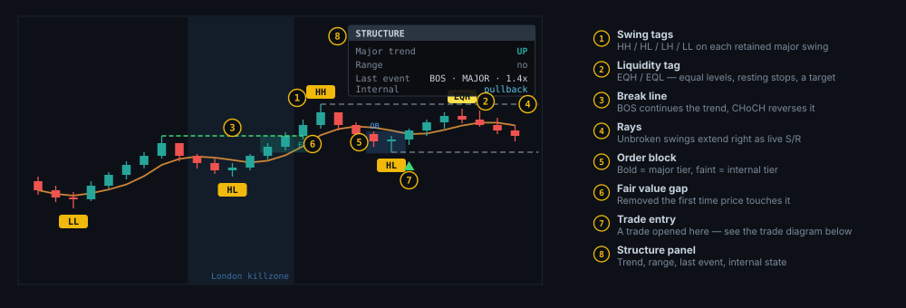
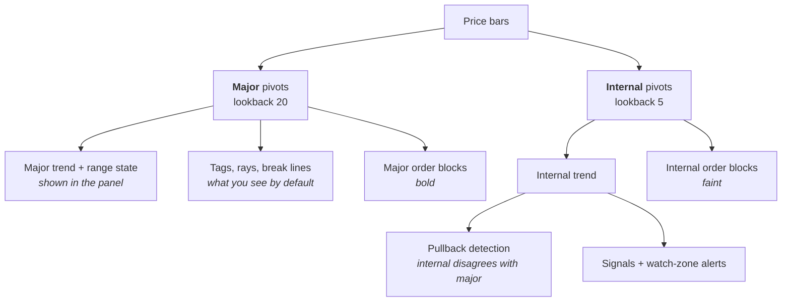
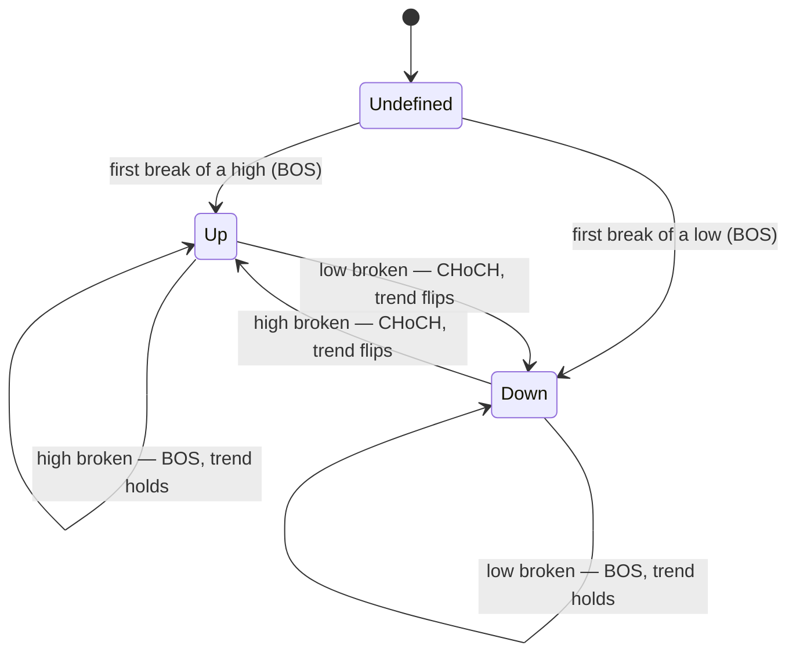
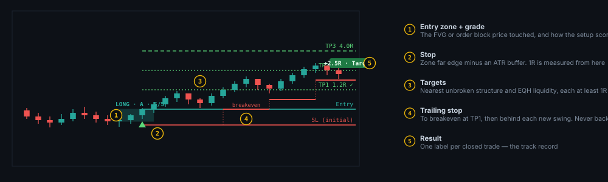
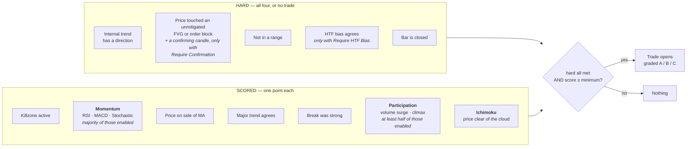
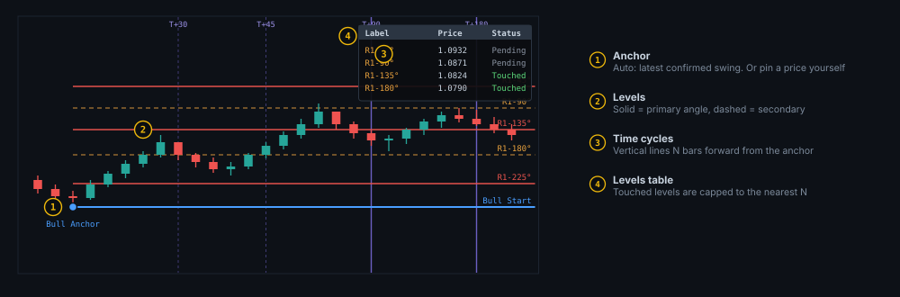

🌐 [اقرأ هذا بالعربية](README.ar.md)

# TradingView Indicators

Three Pine Script v6 indicators for TradingView, written to be read as much as used. Each is a single
self-contained file — no libraries, no data source beyond what TradingView itself serves, nothing to
install beyond pasting the script into TradingView.

| Script | What it does | Pane |
|---|---|---|
| [`src/ict-rsi-ma-indicator.pine`](src/ict-rsi-ma-indicator.pine) | Market structure, order blocks, fair value gaps and session killzones, scored into graded trade setups with an entry zone, a stop, targets and a trailing stop | On the price chart |
| [`src/gann-angles.pine`](src/gann-angles.pine) | Gann price levels (three modes) projected from an automatic or manual anchor, plus Gann time cycles | On the price chart |
| [`src/egx-trust-indicator.pine`](src/egx-trust-indicator.pine) | Long-only pullback entries for Egyptian Exchange stocks, gated by the EGX30 or EGX70 index trend. Each entry carries a trust score, a running track record per score band, a stop, a first target and a trail, with a results panel split into tuning and test periods | On the price chart |

They are independent. Run any one on its own, or several together. TradingView caps how many
indicators one chart can hold on its lower plan tiers, so check yours before stacking all three.

---

## Installing

1. Open a chart on [tradingview.com](https://www.tradingview.com).
2. Open the **Pine Editor** (bottom panel).
3. Open the `.pine` file from this repo, copy all of it, and paste it into the editor, replacing
   whatever is there.
4. Click **Add to chart**.
5. To keep it: **Save**, give it a name, and it appears under *Indicators → My scripts*.

Settings are reached with the gear icon next to the indicator's name on the chart.

---

# ICT + RSI/MA Confluence

## The idea

Price tends to reverse at levels it left in a hurry, and those reversals are worth taking **only when
several independent things agree at once**. This indicator finds those levels, tracks which direction
the market is structurally moving, and marks the bars where everything lines up.

It never tells you to buy. It marks a bar where several independent conditions happened to agree,
grades how many, and leaves the decision to you.

## Reading the chart



### The vocabulary

Most of this comes from "Smart Money Concepts" trading. The terms sound like jargon but each one
names something simple:

| Term | What it actually means |
|---|---|
| **Swing high / low** | A bar that is higher (or lower) than a set number of bars on both sides of it |
| **HH / HL / LH / LL** | Higher High, Higher Low, Lower High, Lower Low — how one swing compares to the previous one on the same side |
| **EQH / EQL** | Equal High / Equal Low. Two swings at nearly the same price. Stop-loss orders pile up just past them, so price is often drawn there |
| **BOS** | Break of Structure. Price closed past a swing **in the direction the trend was already going** — continuation |
| **CHoCH** | Change of Character. Price closed past a swing **against** the trend — this is what flips the trend |
| **Order block** | The last opposite-coloured candle before a structural break. Often revisited before price continues |
| **FVG** | Fair Value Gap: a three-bar pattern where the middle bar moved so fast it left a price gap. Price frequently returns to fill it |
| **Killzone** | A time window when a major session is active (London, New York, and optionally Asia). Volume concentrates here |

## How the structure engine works

Swings are detected at **two sizes at once**, because one setting cannot do both jobs. A small
lookback finds every wiggle — useful for timing an entry, useless for reading a trend. A large one
reads the trend cleanly but hides every level you'd actually trade off.



Both tiers run the same pipeline independently. The panel shows the major tier; the signal engine
currently reads the internal tier.

### BOS vs CHoCH — the trend state machine

The trend only ever changes on a **CHoCH**. A BOS confirms the trend you already had.



A break is only recorded when a **closed** bar closes past the level. A wick through it is not a
break, so nothing appears and then disappears on you.

Every break also records how hard it broke — the breaking candle's body divided by ATR — so a
convincing break and a barely-there one are distinguishable rather than one being silently discarded.

### The range state

Trend is not the whole story: a market can be technically "up" while going nowhere, and that is where
trend-following signals do the most damage. So a separate **Range** flag is raised when the last two
major highs and last two major lows all fit inside a narrow band (default 2.5 × ATR) **and** those
four swings are recent (default within 100 bars).

The second condition matters — without it, four swings scattered across hundreds of bars could
coincidentally sit in a narrow band and read as consolidation when nothing of the sort happened.

> **Range is a hard veto.** No trade opens while it reads `YES`, however good the setup looks — that is
> the point of tracking it. It is also shown in the panel so you can apply your own judgement to
> everything else on the chart.

### The structure panel

| Row | Meaning |
|---|---|
| **Major trend** | `UP`, `DOWN`, or `—` before the first break |
| **Range** | `YES` when structure is compressing — treat trend signals with suspicion |
| **Last event** | The most recent break: type, which tier, and its strength in ATR (e.g. `BOS · MAJOR · 1.4x`) |
| **Internal** | `aligned` when both tiers agree; `pullback` when the small tier is moving against the big one — often the setup you want |

## The trade engine

A triangle no longer just means "conditions agreed" — it means **a trade opened**, with an entry
zone, a stop, three targets and a stop that trails. One trade runs at a time; while it is open,
further setups are ignored.



### How a setup qualifies

Two different kinds of condition, and the difference matters:



The hard four are absolute because without them there is nothing to compute — no direction means no
side, and no zone means no entry price and no stop.

**Three optional trade filters** sit alongside them, all off by default (**Trade Filters** in
Settings). `Require HTF Bias` adds a fifth hard condition: the trade must agree with structure on a
higher timeframe, read one closed HTF bar back so it never repaints. `Require Displacement` acts
earlier — it stops weak zones being created at all, so a gap or order block that did not come from a
real impulse candle is never drawn and never traded. `Require Confirmation` changes *when* a touch
counts: instead of trading the touch bar itself, it remembers the touch and waits up to
`Confirmation Max Wait` bars for a candle that closes in the trade's direction, using the original
touch's zone and stop the whole time. They are filters rather than score points on purpose: the
score's direction has not held up consistently across symbols, so these decide which setups exist
instead of adding votes to it.

**HTF Bias and Displacement: tested, and not an improvement at their defaults.** Across ten charts
(four EGX dailies; ETH, SOL and XRP on 4H and 1H), each filter raised average R on only four, and
every filtered setting did worse than no filter when the charts were pooled. They helped weak
baselines and hurt strong ones. Leave them off unless you are testing them on your own symbol. Full
readings are in `docs/superpowers/plans/2026-09-17-htf-displacement-filter-validation.md`.

**Require Confirmation exists because of what those two tests ruled out.** Logging every closed
trade (`Log Closed Trades`, below) and reading it back showed that on two symbols independently,
over half of all trades never even reached 1R in their favor before failing — drifting against the
position for several bars rather than failing instantly, the signature of a touch that fires before
the reversal has actually started. Neither HTF Bias (which checks direction) nor Displacement (which
checks the zone's formation) touches that mechanism; Confirmation targets it directly. Full data in
`docs/superpowers/plans/2026-09-17-trade-log-root-cause-diagnosis.md`.

**Tested, and it splits cleanly by market.** Across the same ten charts as the HTF/Displacement
test: **all four EGX daily charts improved substantially** — Avg R roughly tripled on two of them,
and one flipped from a small loss to solidly positive, with both B and C grades landing positive on
every one of them. **Crypto 4H/1H was mixed to worse** — two charts improved marginally, four gave
back real R, one by nearly nine-tenths. Read as one number the filter still roughly doubled pooled
Avg R (+0.078 → +0.159), but that average hides the split. **Recommendation: turn this on for EGX
daily equities; leave it off for crypto intraday, or test per symbol there.** Default stays off.
Full readings in `docs/superpowers/plans/2026-09-18-confirmation-filter-validation.md`.

**The score is out of however many points you switch on, not a fixed seven.** That is deliberate.
Killzones mean nothing on a single-session market like EGX, so if killzone were a mandatory veto the
indicator would go permanently silent there. Switch the killzone point off and the panel reads `5/6`
instead of `5/7` — the threshold adjusts rather than quietly loosening. The same happens
automatically for points that cannot apply: turn off both killzone sessions and the killzone point
removes itself, and on a symbol that reports no volume at all the participation point removes itself.

**Three of the five confirmations share votes, on purpose.** RSI, MACD and Stochastic all measure
momentum from the same price series — counted separately they would cast three of ten votes for
what is really one opinion, and a setup could clear the threshold on momentum agreeing with itself.
They share the Momentum point, earned when at least half the enabled ones agree. Volume and the
climax candle share Participation the same way.

**Grades are a fraction of the enabled points** — A at 90%, B at 75%, C below that. So a grade means
the same thing whether you run four points or seven.

Set `Minimum Score` equal to the number of enabled points to get the strictest possible behaviour.

> **Upgrading from an earlier version?** `Minimum Score` now defaults to 5, because 4 out of seven
> points is a *looser* gate than the 4 out of five it used to mean. TradingView keeps the value saved
> on your chart, so if yours still reads 4, raise it by hand.

### Entry, stop and targets

| | Where it comes from |
|---|---|
| **Entry zone** | The FVG or order block price just touched — the range in which the setup is valid |
| **Entry price** | The signal bar's close. Not the zone midpoint: the close is what a market order would actually have got |
| **Stop** | The zone's far edge, plus an ATR buffer so an ordinary wick doesn't clip it |
| **1R** | Entry minus stop. Every R figure on the chart uses the *initial* stop, never the trailed one |
| **Targets** | The three nearest unbroken structure levels ahead, plus any EQH/EQL liquidity pool, each at least 1R away. If structure can't supply three, the rest fill at 1R/2R/3R |

A zone can sit close enough to price that the buffered stop lands a fraction of an ATR away. An
ordinary bar then takes that stop out for many multiples of R, because the denominator was tiny, not
because the setup was bad — the same failure mode the trailing model's own risk floor exists to
prevent (see below). `Minimum Risk (× ATR)` rejects a zone touch below that floor before it opens a
trade; set it to 0 to take every touch, which is what produced the earlier record.

### How the stop moves

1. **TP1 hit** → stop moves to entry. The trade can no longer lose.
2. **After that** → it follows each newly confirmed swing low (for a long), from whichever tier you
   pick in `Trailing Tier`. Internal trails tightly; Major gives the trade room.
3. **It never moves backwards.**

A trade closes when the stop is hit, when TP3 is reached, or when a **CHoCH** prints against it — you
can be wrong structurally without price having to travel all the way to your stop.

Two details that stop the results flattering themselves: if a bar's range spans both your stop and a
target, the trade is recorded as **stopped** (a bar-by-bar script cannot know which came first, so it
assumes the unfavourable one); and if a bar *gaps* through the stop, the exit is recorded at the open,
not at the stop price.

### Three exit modes worth testing

All three are off by default, so nothing above changes until you turn one on. They exist because the
default exit profile — wick-triggered stop, breakeven at TP1, hard close at TP3 — is tuned for clean
instruments, and gives back most of a trend on a thin one.

| | What it changes | When it helps |
|---|---|---|
| **Stop on Close Only** | The stop asks whether price *held* beyond it at the close, not whether a wick *reached* it. The exit is then recorded at that bar's close | Thin or wicky instruments — EGX dailies especially — where an intrabar touch hands back trades the close never confirmed |
| **Runner (no exit at TP3)** | TP3 becomes a waypoint. The last third keeps running behind the trailing stop until the stop or a CHoCH takes it out | Trending instruments, where one trade needs to pay for several stopped ones. A trade that runs to TP3 and closes there is a capped winner by construction |
| **Trail From Entry** | The structural trail runs from the open, and the jump to breakeven at TP1 is skipped | Strong continuations, where breakeven-at-TP1 hands the trade back at 0R on the first ordinary pullback |

Read the trade-offs before switching them on. **Stop on Close Only** takes a worse fill by design —
you are paying the distance between the stop and the close in exchange for surviving wicks. **Trail
From Entry** means a trade can still lose a full R *after* reaching TP1, which the default cannot;
the `BE+` mark on the panel tests the stop against entry rather than assuming, so it tells you
whether the trade is actually protected. **Runner** holds the single trade slot open longer, and
every setup that appears while it runs is skipped.

Runner changes the scale-out accounting to match: a third leaves at TP1 and a third at TP2, and the
final third is priced at wherever the trade actually closed rather than at TP3. Without that, a
runner would book a gain at TP3 it never took and stay capped at TP3's R — the exact understatement
the mode exists to remove.

## The second entry model

The pullback engine above has a structural blind spot, and it is not a tuning problem. Order blocks
are created **by** a break and anchored behind it, and a zone is never tested against its own
creation bar — so on an impulsive one-way move the zone is born below price and is never touched.
The engine cannot participate in a trend that does not retrace, however the touch rule is relaxed.

The `Trailing Stop Model` is a second entry model that references no zone at all. A Chandelier-style
trail hangs a fixed ATR multiple below the running high (above the running low when short),
ratcheting only in the trade's favour, and the side flips when price closes through it. **Entry is
the flip bar** — a discrete event, so entries never become a continuous "we are in a trend" state
that re-enters every bar.

The point of the flip entry is *where* it lands. A break-of-structure entry buys the close of the
breakout candle with the stop back at the base, which is the worst of both: maximum entry price and
maximum risk. A trail flip fires inside the base, before the move, so risk is roughly
`Trail ATR Multiple × ATR` rather than the full distance back down to the range low.

| Setting | Default | What it does |
|---|---|---|
| Enable Trailing Stop Model | **off** | Nothing about the pullback model changes while this is off |
| Trail ATR Length | 14 | ATR used for the trail distance |
| Trail ATR Multiple | 2.0 | How far the trail sits from the running extreme — **this is the model's risk per trade** |
| Trail Extreme Lookback | 22 | Bars in the running high/low the trail hangs from |
| Trail Minimum Target Distance (R) | 1.0 | This model's own target floor, separate from the pullback model's |
| Trail Minimum Risk (× ATR) | 1.0 | Rejects a flip whose entry sits closer to its own trail than this — see below |
| Require Trend Agreement | on | Only take flips agreeing with internal structure, and stand down in a range. Off makes this a standalone trend system |
| Apply Minimum Score | **off** | See below |
| Trade Follows the Trail Line | **on** | The open trade's stop ratchets along this model's own Chandelier line, from entry |
| Show Trail Line | off | Draws the trail on the price chart |

`Apply Minimum Score` is off by default on purpose. On the record so far the score is
**anti-predictive** — the highest-graded setups lose the most — so gating a new model on it would
import that problem into the one thing built to test it independently. The grade is still *recorded*
for every trail trade, so its grade split is readable; it just does not filter entries unless you
turn this on.

### Why the minimum risk floor exists

A flip can fire with the close sitting almost exactly on its own trail line, and nothing else in
the model bounds that distance — it is simply wherever the flip bar closed relative to the line.
That produces a stop **inside a single bar's range**, which an ordinary bar takes out for a
near-full R regardless of whether the read was right.

This was invisible while the trade's stop stayed frozen at its entry value: a tiny R just inflated
the R multiple on every winner and made the model look far better than it was. Once the stop
started tracking the line, the same trades began dying at close to a full stop each, and the
model's record inverted. Both readings were measuring the missing floor, not the model.

Set it against reality rather than guessing: `DBG Trail Flip Risk (ATR)` in the Data Window reports
the entry-to-trail distance at every flip, in ATR. Read it across a handful of flips and the right
floor is obvious. Setting it to 0 disables the floor and takes every flip.

The live trade's `Entry` row now also carries its risk in ATR terms — `22.98 · 0.7x ATR`. Anything
much under 1.0 is a stop the instrument's own noise will reach, on either model.

### The trade follows the line that opened it

`Trade Follows the Trail Line` is on by default, and the reason is worth stating because the
alternative looked reasonable and was not. The two models share one exit engine, and that engine
trails on **structural swing lows** — correct for the pullback model, wrong here. With it, a trail
trade took its entry stop from the Chandelier and then ignored that line for the rest of its life,
so the stop sat near entry, moving only when a swing low happened to confirm. A trade could be
several R in profit with its own signal already flipped against it and nothing protecting the gain.

With this on, the stop ratchets along the Chandelier line itself, from the moment the trade opens.
Because a flip fires when price closes through that same line, the trade now exits at or before the
flip rather than outliving it. The stop still only moves one way — the line resets lower once price
closes through it, and a stop that has already ratcheted up must never follow it back down.

Turning it **off** restores the old behaviour. That exists to reproduce an earlier record for
comparison, not as a sensible way to run the model.

### The two models never compete

Each model holds **its own trade slot** and **its own performance record**. A trail trade cannot
block a pullback trade or vice versa, and neither model's `n`, win rate, average R or grade split
includes the other's trades. That separation is the entire reason for the design: averaged together,
a model that works and one that does not read as a single mediocre number and neither can be judged.

With the trail model enabled the panel grows a second `PERFORMANCE · TRAIL` block beside
`PERFORMANCE · PULLBACK`, and a live trail trade gets its own `TRAIL TRADE` rows. Its exit labels
carry a `· T ·` marker so the two models' records stay legible when you scroll back. When both
models close on the same bar, the trail label is pushed clear of the pullback one rather than
stacking on top of it — two labels at the same point hide one completely, which reads as a trade
that never happened. With it
disabled the panel is row-for-row what it was.

**Before enabling it, write down the pullback model's current `n` and `Total R`.** With the model
off those two numbers must not move. If they do, something shared was touched and it is a bug —
that check is worth more than any reading you take with the model on.

### Reading the trade panel

The panel carries a `Confirm` row showing the three confirmation points for the current bar —
`Mom ✓ · Part — · Ichi ✓`. A dash means the point is switched off or cannot apply; a cross means it
applies and is not met. `5/7` tells you a setup was adequate, but the row tells you *which* points
carried it, which is the part you can act on.

Under it, the `Gate` row says what is stopping a trade **right now**:

```
Gate    L · no zone touch · 5/6
```

Side, the first unmet requirement, and the live score over the points currently enabled. The reason
is the one thing to act on, in the order the gate applies its checks:

| | Meaning |
|---|---|
| `no trend` | The internal tier has no direction yet |
| `in range` | Price is inside a major range — the engine stands down |
| `htf bias` | `Require HTF Bias` is on and higher-timeframe structure points the other way, or has no direction yet |
| `awaiting confirmation` | `Require Confirmation` is on and a touch is being watched for a same-direction candle. Clears itself, one way or the other, within `Confirmation Max Wait` bars |
| `no zone touch` | **The common one.** Price has not traded back into an FVG or order block. This is a hard requirement, not a scored point: no amount of score tuning produces a trade while it reads this |
| `score short` | Everything structural is met and the score is below `Minimum Score` |
| `bar not closed` | Everything is met and the bar is still live. On a daily chart this is what you see while waiting for the close |
| `READY` | A trade fires on this bar |

The score fraction is the reason this row exists. Everywhere else the score only renders inside a
live trade's rows, so on a bar where nothing fires there is no surface that reflects a scoring input
you just changed — switch `Score: Killzone` off and the panel would look identical, with the change
real but invisible. The same numbers publish to the Data Window every bar as `DBG Live Score`,
`DBG Live Points Enabled`, and one plot per hard-gate condition.

The structure panel grows extra rows while a trade is live: the setup and its grade with the score
fraction, entry, the current stop with its R distance, all three targets with R multiples and tick
marks as they are reached, and the trade's open R. A runner is tagged `RUN` on the first of those
rows, because a trade with no exit at TP3 is a different trade from one that closes there.

When a trade closes it leaves a single label at the exit bar — `+2.5R · Target`, `−1.0R · Stopped`.
Scroll back and those labels are your per-trade record; the `PERFORMANCE` rows are the same
results added up.

```
PERFORMANCE    n = 24
Win rate       58%  (14W / 10L)
Avg R          +0.34R
Total R        +8.17R
A grade        +0.70R  (6)
B grade        +0.45R  (11)
C grade        −0.14R  (7)
```

The grade split is the row worth staring at. If C-grade setups lose money and A-grade ones don't,
`Minimum Score` is set too low — that is the feedback loop the score never had.

**Results assume you scale out in thirds**: one third of the position leaves at each target
reached, and whatever is left exits at the stop, the final target, or the bar close on a CHoCH
invalidation. The indicator itself manages one unit and draws no partial exits, so this is an
accounting convention, not something you can see on the chart. It is there because under
single-unit accounting a trade that reaches TP2 and then trails back to breakeven scores 0R — which
makes TP1 and TP2 nearly decorative and understates the engine badly enough to mislead any tuning
you do against these numbers. One consequence: the live trade's `Open R` row is single-unit and
**will not** match the blended figure the same trade reports once it closes — and the same applies
to the exit labels, so a trade that runs to TP3 labels the average of the three targets' R, not
TP3's.

Read `n` before you trust a percentage. The sample is whatever history TradingView loaded, capped at
5000 bars — on a 15-minute chart that is under two months, and a 58% win rate over twelve trades is
noise. These are also the results of the indicator *as configured*, not of the underlying pattern:
only one trade runs at a time, so every setup that appeared while a trade was open is missing from
the count. Change any setting and the whole history recomputes, which is the point — it makes the
panel a way to compare settings, not a fixed track record.

> **On cash-equity markets where you can't short**, set `Long Trades Only`. Bearish setups still mark
> and still alert, so you keep the information — they just don't open a trade.

## Alerts

Set these up with the alarm-clock icon → *Condition: ICT + RSI/MA Confluence*.

| Alert | Fires when |
|---|---|
| Bullish / Bearish Trade Entry | A trade opened — or, for the bearish one, a short setup qualified but was suppressed by `Long Trades Only` |
| Trade Opened | Any trade opened; check the panel for side, grade, stop and targets |
| Target Hit | A take-profit level was reached |
| Trade Closed | The trade ended — the result label on the chart carries the R and the reason |
| Bullish / Bearish Watch-Zone | Price is approaching an unmitigated zone during a killzone — a heads-up, not a signal |
| Major CHoCH | The major trend reversed |
| Major BOS | The major trend continued |

TradingView alert messages can't carry script values, so they point you at the chart rather than
claiming to quote a price or an R figure.

## Settings

**Market Structure** — the engine.

| Setting | Default | What it does |
|---|---|---|
| Major Swing Lookback | 20 | Bars either side a bar must dominate to count as a major swing. Bigger = fewer, more meaningful swings |
| Internal Swing Lookback | 5 | The fine tier. Also what signals read |
| Max Swings Kept | 10 | Per side, per tier. Broken swings are kept (not deleted) until this cap pushes them out |
| Structure ATR Length | 14 | Scales the three settings below |
| Equal-Level Tolerance (× ATR) | 0.15 | How close two swings must be to count as EQH/EQL |
| Range Band (× ATR) | 2.5 | How tight the four swings must be to call it a range. Lower = stricter |
| Range Lookback (bars) | 100 | How recent those swings must be |

**Trade Engine** — the gate and the trade.

| Setting | Default | What it does |
|---|---|---|
| Minimum Score | 5 | Points needed, out of however many are enabled below |
| Score: Killzone | on | **Turn off on single-session markets like EGX** |
| Show Asia Killzone | off | On for 24-hour markets like crypto — off by default so it doesn't change existing saved charts |
| Score: Moving Average | on | Whether price is on the trade's side of the MA |
| Score: Major Trend Agreement | on | Whether the major tier agrees with the internal one |
| Score: Break Strength | on | Whether the break that set up the trade was a big candle |
| Strong Break (× ATR) | 1.0 | How big that candle's body must be to earn the point |
| Stop Buffer (× ATR) | 0.25 | How far beyond the zone edge the stop sits |
| Minimum Risk (× ATR) | 1.0 | Rejects a zone touch whose stop lands closer than this — same floor and reason as Trail Minimum Risk |
| Minimum Target Distance (R) | 1.0 | Structural levels closer than this are skipped |
| Trailing Tier | Internal | Which tier's swings the stop trails behind |
| Stop on Close Only | off | Exit only when a bar **closes** beyond the stop, instead of the moment its wick touches |
| Runner (no exit at TP3) | off | Treat TP3 as a waypoint; the last third rides the trailing stop instead |
| Trail From Entry | off | Trail structurally from the open, and skip the jump to breakeven at TP1 |
| Long Trades Only | off | For markets where you can't short |
| Show Gate Panel Row | on | One row naming what is currently stopping a trade, with the live score |
| Show Performance Rows | on | Win rate, average R and a per-grade split over the loaded history. The counters run whether or not this is on |
| Show Confirmation Point Stats | off | Avg R when each of the 7 confirmation points was true vs. false at entry — independent of whether the point currently counts toward the score. Off by default; adds up to 7 rows per model |
| Log Closed Trades | off | Writes one CSV line per closed trade to TradingView's Pine Logs panel (chart legend → indicator's **···** menu → **Pine logs…**): times, zone type, entry/stop/targets, result in R, best and worst excursion in R (MFE/MAE), bars held, and the 7 confirmation points. Only works on a personal, unpublished script — TradingView disables `log.*()` on published or invite-only ones. The panel's own **···** menu → **Download logs** exports the full history as a CSV in one shot |

**Trade Filters** — hard filters for the pullback model, all off by default. With all off, results
are identical to running without them.

| Setting | Default | What it does |
|---|---|---|
| Require HTF Bias | off | Only take trades in the direction of the last higher-timeframe structure break. No HTF break yet means no bias and no trade. Turns itself off when the chart is at or above Bias Timeframe |
| Bias Timeframe | 1D | Use 1D on 1H–4H charts, 1W on a daily chart |
| HTF Swing Lookback | 5 | Swing size on the higher timeframe, in HTF bars |
| Require Displacement | off | Only create FVGs and order blocks born from an impulse candle. Filtered zones are never drawn, alerted or traded |
| Displacement (× ATR) | 1.0 | Minimum body of that impulse candle — the FVG's middle candle, or the candle that broke structure for an order block |
| Min FVG Size (× ATR) | 0.3 | Minimum gap height for an FVG |
| Require Confirmation | off | Don't trade the touch bar. Remember the touch and wait for a candle that closes in the trade's direction, up to Confirmation Max Wait bars later — using the original touch's zone and stop throughout |
| Confirmation Max Wait (bars) | 3 | A touch with no confirming candle within this many bars is abandoned, not taken late |

**Confirmations** — three more scored points, five indicators.

| Setting | Default | What it does |
|---|---|---|
| Score: Momentum | on | One point for RSI, MACD and Stochastic together — earned when at least half the enabled ones agree (2 of 3, 1 of 2) |
| Momentum: RSI / MACD / Stochastic | on | Which indicators are members of that vote. Turn all three off and the point leaves the denominator |
| MACD Fast / Slow / Signal | 12 / 26 / 9 | Standard settings |
| Stochastic %K / Smoothing / %D | 14 / 3 / 3 | Read as a %K/%D cross, not an overbought level — in a trend the oscillator pins to its extreme and a level test would veto every continuation |
| Score: Participation | on | One point for evidence someone is actually trading here |
| Participation: Volume Surge | on | Volume on the bar that touched the zone, against its own average |
| Participation: Climax Candle | on | An exhaustion bar **against** the trade — for a long, a heavy down bar closing on its low into support. That is the pullback spending itself |
| Volume Average Length | 20 | Bars in the volume average that surge and climax both measure against |
| Volume Surge (× average) | 1.5 | How far above average counts as a surge |
| Climax Range (× ATR) / Volume (× average) / Lookback | 2.0 / 2.0 / 3 | How big an exhaustion bar has to be, and how recently it can have printed |
| Score: Ichimoku | on | One point when price is clear of the cloud on the trade's side. Inside the cloud earns nothing |
| Tenkan / Kijun / Senkou B / Displacement | 9 / 26 / 52 / 26 | Standard settings |
| Show Kumo Cloud | **off** | The only thing this section draws |
| Show Confirmation Panel Row | on | Adds `Mom ✓ · Part — · Ichi ✓` to the panel, so you can see which points carried a setup |

Chikou is deliberately absent: it is the close displaced 26 bars *backwards*, so scoring on it would
report confirmation that was not available at the time. MACD and Stochastic are never plotted —
this script draws on the price chart, and an oscillator has no pane to live in here.

**Structure Display** — what gets drawn. Internal rays and internal break lines are **off** by
default; on a fast timeframe they are near-continuous. Leave internal break lines off if you want a
long trade history to survive — their labels share the chart's 500-label budget with your result
labels. `Panel Position` defaults to **Bottom Right**, not Top Right: TradingView's own expanded
indicator-legend bar (the input list shown when the legend is hovered or pinned open) sits near the
top of the chart and renders on top of the panel there, cutting through rows instead of sitting
behind them. `Panel Background` controls the whole STRUCTURE/PERFORMANCE/POINTS panel's background
color and opacity in one control — header rows keep their own gray highlight on top of it.

**Fair Value Gaps / Order Blocks** — `Max Tracked` caps how many are kept per side (order blocks: per
side *and* per tier). `Include Internal-Tier Order Blocks` is on by default; turning it off leaves
only order blocks born from major structural breaks — far fewer, each more significant.

**Killzones** — session windows and their timezone, which defaults to `America/New_York` (the
convention the London/New York hour ranges are quoted in — changing the timezone re-interprets the
same hours against a different clock rather than shifting the sessions). **RSI / Moving Average** — the periods behind the
RSI readout and the MA plot; RSI is also a member of the Momentum vote in **Confirmations**, above.
**Alerts / Display** — signal markers, the RSI readout, and how close price must get to a zone to
count as a watch-zone.

---

# Gann Angles

## The idea

W.D. Gann's methods project support and resistance from a single significant turning point, in
**price** and in **time**. This script picks that turning point for you (or takes one you type in),
draws the levels, and tells you which have already been reached.

## Reading the chart



## Three modes

| Mode | What it draws | Anchors needed |
|---|---|---|
| **Square of 9** *(default)* | Levels at 22.5° increments around Gann's spiral, in rings of 16 | One per direction |
| **Gann Fan** | Nine angled rays (1×8 through 8×1) read at a chosen bar distance, drawn as horizontal levels | One per direction |
| **Gann Square** | A box between a bullish and a bearish anchor, divided into a grid | **Both**, with the bearish price above the bullish one |

## Anchors

By default each side anchors to the **most recent confirmed swing** — a low for the bullish side, a
high for the bearish. "Confirmed" means the script waits `Swing Pivot Lookback` bars to be certain,
so a fresh anchor always appears that many bars after the actual turn.

To pin an anchor yourself, type a price into `Bullish Price` or `Bearish Price` (leave `0` for
automatic) and set the matching start date.

## Time cycles

Independently of the price levels, vertical lines mark 30, 45, 60, 90, 120, 144, 180, 270 and 360
bars forward from each anchor — dates Gann considered likely for a turn. The time table lists each
with its projected calendar date and whether it has been reached.

A `~` before a date means it was extrapolated from average bar spacing rather than read from a real
bar — which is what happens for cycles that lie in the future.

## The levels table

Each row is one level: its label, its price, and whether price has already **Touched** it or is still
**Pending**.

On a long chart nearly everything reads *Touched*, which buries the levels that still matter. So
`Max Touched Levels` (default 5) keeps only the touched levels **nearest current price** and hides the
rest — per direction, and applied to the lines and labels as well as the table, so you never see a
line with no row explaining it. Set it to `0` to hide touched levels entirely, or `100` to show
everything.

## Square of 9 scaling

Gann's spiral adds **+2 to the square root of price per 360° revolution** — so 22.5° is `+0.125`,
which is exactly what the level formula does and what makes a level a Gann level. That part is not
negotiable and is untouched.

What *is* a choice is the **root** the spiral starts from, and it turns out the root alone fixes the
whole geometry: a revolution costs `((root+2)/root)² − 1` regardless of price, and each 22.5° step is
a sixteenth of that. Pick the root badly and every level is wrong.

Deriving it from **price** cannot work, for two independent reasons:

- Price is identical on a daily and a monthly chart, so a price-derived root draws the same grid on
  both. On a weekly chart that leaves a single candle crossing five levels — or twenty-two on SHIB.
- Raw prices span ten orders of magnitude here. `√8598 = 92.7`, so an unscaled revolution on EGX30 is
  4.4%; on sub-cent crypto the first level lands *thousands* of percent away and every bearish level
  falls off the bottom of the spiral.

So `Auto Scale to Volatility` (on by default) derives the root from the **ATR held at the anchor**,
sizing one revolution at `ATRs per Revolution` (default 16). Since a revolution is 16 levels, that
leaves adjacent levels about **one ATR apart** — far enough that routine single-bar noise cannot
sweep several. It adapts on all three axes at once: coarser on monthly than weekly than daily, wider
on volatile instruments, and unaffected by price magnitude because `ATR/price` is a ratio.

Measured on EGX30 from one pinned anchor, changing nothing but the timeframe:

| timeframe | root | step per level |
|---|---|---|
| Daily | 14.25 | 1.76% |
| Weekly | 5.91 | 4.27% |
| Monthly | 2.85 | 8.96% |

Bearish levels descend as `root − n×0.125` and genuinely run out once the steps catch the root — the
spiral has a floor, so on a volatile chart fewer bearish rings fit than bullish ones. That asymmetry
is real and is left alone; an earlier attempt to force the count even by flooring the root bound on
every chart coarse enough to need it, and handed weekly and monthly EGX30 identical levels.

The Start row's Status cell shows the live **root**, since that single number fixes the whole
geometry — it makes the scaling auditable instead of something to take on trust.

Turn the switch off for literal unscaled Gann, dialled by hand with `Scale Factor`.

## Settings worth knowing

| Setting | Default | What it does |
|---|---|---|
| Mode | Square of 9 | Which geometry to draw |
| Swing Pivot Lookback | 50 | How major a turn must be to anchor to. Higher = fewer, bigger anchors, confirmed later |
| Rings *(Square of 9)* | 2 | Each ring is 16 levels. Max 3 |
| Auto Scale to Volatility *(Square of 9)* | on | Derives the spiral's root from the anchor ATR so levels land ~1 ATR apart on any instrument and timeframe. See above |
| ATRs per Revolution *(Square of 9)* | 16 | How far a full 360° turn runs, in anchor ATRs. 16 levels per revolution, so 16 ≈ one ATR per level. Raise to coarsen |
| Scale Factor *(Square of 9)* | 1.0 | Only read with Auto Scale off. Spacing goes as 1/√(anchor price × this): higher tightens, lower spreads |
| ATR Length | 14 | Sets the price-per-bar unit for Fan slopes and Square width. Sampled once at the anchor and held, so the geometry does not drift |
| Max Touched Levels | 5 | Per direction. See above |

The two tables must sit in **different screen corners** — TradingView draws only one table per
position, so if `Table Position` and `Time Table Position` match, one hides the other.

---

# EGX Trust Score

## The idea

A pullback in a stock that is itself in an uptrend, inside a market that is not falling, is one of
the older and plainer setups there is. This indicator looks for exactly that on Egyptian Exchange
stocks: a sharp oversold dip, then a first sign of recovery, taken only when the index and the stock
agree that the trend is up. It is **long only** and built for the daily chart, though every length is
counted in bars so it runs on any timeframe up to monthly.

Each entry arrives with a **trust score** (0 to 100) built from six independent factors, and with the
running **track record** of how entries in that score band have actually done on this chart so far.
The score is never fitted to results. The track record is the check on whether the score means
anything.

## Which index it reads

An EGX stock is judged against the index it belongs to, so the script has to know which one that is.
Pine cannot look up index membership, so the EGX30 and EGX70 constituent lists are written into the
script itself and stamped with a `LIST_DATE` constant, shown at the top of the panel as
`lists 2026-11-01`.

`Index` has three settings:

| Setting | What happens |
|---|---|
| **Auto** *(default)* | The stock's ticker is looked up in the built-in lists. The panel reads `EGX30 (Auto)` or `EGX70 (Auto)` |
| **EGX30** / **EGX70** | You choose. The panel reads `(Override)`. Use this when the lists are stale |
| *(Auto, ticker in neither list)* | Falls back to EGX30 as a proxy for the market and the panel reads `EGX30 (Unlisted)` in orange. Treat the regime reading as approximate |

EGX rebalances both indices **twice a year**, so the lists go stale. To refresh them, open the
current constituents for EGX 30 and EGX 70 EWI on egx.com.eg, replace the `EGX30_LIST` and
`EGX70_LIST` strings at the top of the script, and bump `LIST_DATE` in the same edit. The tickers sit
between commas on purpose, so `VLMR` can never match inside `VLMRA`. In between rebalances, `Index`
set to EGX30 or EGX70 gets you the right answer without touching the code.

The index is read from `EGX_DLY:EGX30` or `EGX_DLY:EGX70EWI`, on the chart's own timeframe and
without lookahead, so on a historical bar the index value is the one that bar could actually have
seen.

TradingView's EGX 70 EWI history starts in mid-2020. Before that, an EGX70 stock is gated by EGX30's
trend instead. The Index row in STATUS then reads `· EGX30 proxy to <date>` (in orange). This is a
stand-in for history TradingView doesn't have, not a claim that EGX30 and EGX70 move together.

## The index regime and the three gates

The index is classified on every bar:

| Regime | Rule |
|---|---|
| **Up** | The index closes above its `Index MA Length` average, and that average is above its own value `Slope Lookback (bars)` bars ago |
| **Down** | The index closes below the average, and the average is below its value `Slope Lookback (bars)` bars ago |
| **Neutral** | Anything else |

A setup can only **start** when all three gates are open, and it is dropped if the regime or
liquidity gate closes while it waits:

1. **Regime gate.** The regime is not Down. If the index has no data for that bar the gate stays
   **shut** rather than passing as "not Down", so a missing index can never quietly let trades through.
2. **Trend gate.** The stock closes above its `Long MA Length` average. If the chart has fewer bars
   than that, the gate is **skipped**, not failed, and the panel says so: `skipped (<200 bars)`.
3. **Liquidity gate.** The 20-bar average of close × volume is at least `Min Avg Value Traded (EGP)`.
   Thin EGX70 names do not fill anywhere near their chart prices, so a setup in one is ignored rather
   than recorded as a trade nobody could have made.

## Setup and confirmation

With the gates open, a **setup** arms on the first bar where RSI (length `RSI Length`) falls below
`RSI Oversold Below`. The setup then waits for a recovery. A setup never confirms on its own oversold
bar: a bar that is both an extreme dip and a close above the prior high is a contradiction in
practice, and allowing it would let one bar be both the dip and the turn.

| Rule | Detail |
|---|---|
| **Confirmation window** | A confirming candle must close within `Confirmation Window (bars)` bars after the most recent oversold bar |
| **Re-arming** | A further oversold bar while the setup is alive restarts the confirmation window from that bar and moves the cancel reference to that bar's low. Without it, a 3-bar window would make the 5-bar expiry meaningless |
| **Expiry** | `Setup Expiry (bars)` after the **first** oversold bar, however many re-arms happened |
| **Cancel** | A close more than `Cancel Below Setup Low (x ATR)` ATRs below the latest oversold bar's low; or the regime turning Down; or liquidity falling below the floor |

A **confirming candle** is any one of these:

- a close above the previous bar's high;
- a bullish engulfing candle;
- a hammer: lower wick at least twice the body, close in the top third of the bar's range.

The entry is the **close of the confirming bar**. Only one trade runs at a time, and while one is
open, setups are not armed.

## Stop, Target 1, trail and exits

| | Where it comes from |
|---|---|
| **Stop** | The lowest low from the start of the setup to the entry, minus `Stop Buffer (x ATR)` ATRs, rounded **down to a whole tick** |
| **Risk floor** | The larger of `Min Risk (x ATR)` ATRs and `Min Risk (ticks)` ticks. A stop closer than that is pushed out to the floor |
| **Risk cap** | A setup whose stop would sit further than `Max Risk (x ATR)` ATRs away is **skipped**, not taken with a wide stop |
| **Target 1** | Entry plus `Target 1 (R)` times the risk. Half the position exits here and the stop on the other half moves to breakeven |
| **Trail** | After Target 1: a chandelier trail, `Trail (x ATR)` ATRs below the highest high of the *earlier* bars, never below breakeven. It uses the **previous bar's ATR** and earlier bars only, because raising it with the current bar's own high, or widening it with the current bar's range, and then testing the current low would assume the favourable order inside the bar |
| **Time stop** | A trade that has not reached Target 1 after `Time Stop (bars)` bars exits at the close |

Stops are rounded to a tick because a stop between ticks only fills at the tick below it, so booking
the unrounded price would understate losses on low-priced names.

**What counts as a win.** A trade is a win when it reaches Target 1 before any exit. That is the only
definition used anywhere in the panel and the track record. A high win rate is easy to reach with a
tiny target and a wide stop, which is why **Avg R** and **Total R**, after costs, sit beside it.

**Exit warnings.** Two conditions end an open trade at that bar's close, and a trade that ends this
way before Target 1 counts as a non-win:

- the index regime turns **Down**; or
- the stock **closes below its `Medium MA Length` average after having been above it**, at the entry
  or on any bar since. The "after having been above" matters: a dip is often bought *below* the
  average, and without it every such trade would be stopped out on its next bar for merely being there.

On the chart, the orange `EXIT` marker is drawn on the bar where the stock **crosses** under the
medium average or the regime first turns Down, whether or not you hold a trade. It marks the event
once, not every bar spent under the average, so it is a warning for any holder, while the trade
engine applies the stricter rule above to its own simulated position.

Bar-by-bar scripts cannot see the order of events inside a bar, so they assume the unfavourable one:
a bar that touches both the stop and Target 1 counts as **stopped**. A gap through the stop fills at
the open, worse than the stop; a gap through Target 1 fills at the open, better than the target. On
the bar that reaches Target 1, if price also trades back to the entry, the second half is assumed to
exit at breakeven on that same bar.

When a trade closes, a label shows the result in R and the reason: `Stop`, `Breakeven`, `Trail`,
`Time`, `Exit: Index` or `Exit: Trend`.

## The trust score

Six factor groups, **equal weight**, each worth full credit (1) or half credit (0.5) or nothing (0).
They are measured on the confirming bar. The score is the sum scaled to 0 to 100.

| Factor | Full credit | Half credit |
|---|---|---|
| **Index Regime** | Up | Neutral |
| **Stock Trend** | Close above the medium MA, which is above the long MA | Above the long MA only |
| **Relative Strength** | The stock/index ratio is above its `Relative Strength MA Length` average **and** that average is rising | Above the average only |
| **Support Location** | Two or more supports within 1 ATR of the pullback low | One support |
| **Participation** | Average volume during the pullback below the 20-bar average **and** confirming-bar volume above it | Either one |
| **Confirmation Strength** | Bullish engulfing, or a close in the top 25% of the bar's range | Any other valid confirming candle |

The supports considered are the last confirmed swing low (`Swing Pivot Length` bars either side),
the 20-bar average, the medium MA, and the 38.2% to 61.8% retracement of the last swing up. Each kind
counts once. Momentum oscillators are deliberately absent: RSI, MACD and Stochastic read the same
price series, so they would be one opinion counted several times.

**The weights are never fitted.** If a factor proves anti-predictive on the tuning period, you switch
it off with its `Score:` input, and the score rescales over the factors that remain; it is not
re-weighted to chase results. The inputs are `Score: Index Regime`, `Score: Stock Trend`,
`Score: Relative Strength`, `Score: Support Location`, `Score: Participation` and
`Score: Confirmation Strength`.

Scores fall into three **bands**: **Low** below 50, **Mid** 50 to 74, **High** 75 and above.

### The track record on the label

The score says how good the setup looks. The label also says how entries of that quality have really
done on this chart:

```
BUY · Trust 83 · High 9/12 (75%)
```

The first number is the trust score, then the band, then **wins / closed trades** in that band so
far and the win rate. Those counts pool both the tuning and test periods and use only trades that had
**already closed** before the signal bar, so a label never includes its own outcome. (The numbers
above only show the format; they are not a measured result.) With fewer than
`Track Record Minimum Trades` closed trades in the band, the label reads `High — building history`
instead of quoting a win rate off a handful of trades.

## Reading the panel

The panel has a STATUS block and a RESULTS block, and a costs footer.

**STATUS** — what the script is doing right now.

| Row | Meaning |
|---|---|
| `EGX TRUST` / `lists ...` | Header, and the date of the built-in constituent lists |
| `Index` | Which index, and how it was chosen: `(Auto)`, `(Override)` or `(Unlisted)` |
| `Regime` | `Up`, `Neutral`, `Down` or `No data` |
| `Trend gate` | `Above 200 MA`, `Below 200 MA`, or `skipped (<200 bars)` |
| `Liquidity` | The 20-bar average value traded, in millions of EGP per bar, green when the gate is open |
| `Setup` | `Watching`, `Armed (n bars)` or `In trade` |

**RESULTS** — two columns. **Tuning** counts trades entered before `Test Start`; **Test** counts
trades entered from that time onward.

| Row | Meaning |
|---|---|
| `Trades` | Closed trades |
| `Win %` | Share that reached Target 1, with the number of wins in brackets |
| `Avg R` | Average result per trade, in R, after costs |
| `Total R` | Sum of results, in R, after costs |
| `Max loss run` | The longest run of consecutive non-wins |
| `High (n·win·avg·tot)` | For High-band trades: count, win %, Avg R, then total R |
| `Mid` | The same four figures for the Mid band |
| `Low` | The same four figures for the Low band |

A `—` means there are no trades yet. Trades entered before `Test Start` but closed after it were
decided partly on Test-period prices, so they are counted in **neither** column; they appear only in
the `straddle` count on the footer. The last line of the panel repeats the cost assumptions in force
and that count, for example `costs 0.10%/side + 2.0 EGP/order · straddle 1`.

The panel only renders on the last bar, and results are whatever history TradingView loaded. Read `n`
before you trust a percentage, as with the other indicators.

## Costs

Results include trading costs, so a strategy cannot look good only because it was free.

- `Slippage per Side (%)` is charged on the entry and again on each exit, as a percentage of price.
- `Commission per Order (EGP)` is charged per order: two orders for a trade that exits in one piece,
  **three** when Target 1 split the exit into two.
- `Position Size (EGP)` is used for one thing only: converting the per-order commission into R.

Each result is blended across the two halves: half at Target 1 and half at the final exit if Target 1
was reached, otherwise the whole position at the exit.

## Validation: tune on one period, judge on the other

The `Test Start` date (`Validation` group, default 1 January 2024) splits the history in two.

- **Tuning** is every trade entered before it. This is the column to look at while you adjust
  settings or decide whether to switch a score factor off.
- **Test** is every trade entered from it onward. This is the part you do **not** tune on. Once you
  adjust settings by looking at a period, that period is no longer evidence of how the indicator will
  do on data it has never seen.

The rule that keeps the test column honest: **tune on the Tuning column only**, and read the Test
column once you have finished. Looking at Test, changing a setting and looking again turns it back
into a second tuning set.

### Trade log

`Log Trades` (off by default, in `Display`) writes one CSV line per closed trade to TradingView's
Pine Logs: symbol, entry and exit date and price, R, win flag, close reason, trust score and band, the
six factor values, best and worst excursion in R, bars held, and the period (`Tuning` or `Test`).
Pine Logs only work on a **personal, unpublished copy** of the script; TradingView disables
`log.*()` on published or invite-only scripts. The log is what lets you recompute the panel's totals
outside TradingView and check that they match.

## Alerts

Set these up with the alarm-clock icon → *Condition: EGX Trust Score*.

| Alert | Fires when |
|---|---|
| EGX Trust Entry | A trade opened. The chart label shows the trust score and track record; the stop and Target 1 are drawn as lines |
| EGX Exit Warning | The index regime turned Down, or the stock crossed under its medium MA |
| EGX Trade Closed | The trade ended. The result label carries the R and the reason |

As with the other indicators, alert messages can't carry script values, so they point you at the
chart rather than quoting a price.

## Settings

**Index**

| Setting | Default | What it does |
|---|---|---|
| Index | Auto | Auto looks the ticker up in the built-in lists; EGX30 or EGX70 overrides when the lists are stale |
| Index MA Length | 50 | The average the regime is measured against |
| Slope Lookback (bars) | 10 | An average counts as rising when it is above its own value this many bars ago. Shared by the regime and the relative-strength trend |

**Stock Trend**

| Setting | Default | What it does |
|---|---|---|
| Long MA Length | 200 | The trend gate average |
| Medium MA Length | 50 | The average used by the trend factor, support and the trend exit |
| Relative Strength MA Length | 50 | The average the stock/index ratio is compared with |
| Min Avg Value Traded (EGP) | 2,000,000 | The liquidity gate. Setups below it are ignored |

**Setup**

| Setting | Default | What it does |
|---|---|---|
| RSI Length | 2 | A very short RSI, so it only reaches extremes on real dips |
| RSI Oversold Below | 10 | RSI under this arms a setup |
| Confirmation Window (bars) | 3 | How long after the latest oversold bar a confirming candle can still count |
| Setup Expiry (bars) | 5 | Hard cap counted from the first oversold bar |
| Cancel Below Setup Low (x ATR) | 0.5 | A close this far below the latest oversold low cancels the setup |
| Swing Pivot Length | 5 | Bars either side for swing lows and highs, used as support and for the retracement zone |

**Trade**

| Setting | Default | What it does |
|---|---|---|
| ATR Length | 14 | The ATR every "x ATR" setting is measured in |
| Stop Buffer (x ATR) | 0.25 | How far below the setup's lowest low the stop sits |
| Min Risk (x ATR) | 0.5 | Risk floor in ATRs |
| Min Risk (ticks) | 10 | Risk floor in ticks. The effective floor is the larger of the two |
| Max Risk (x ATR) | 3.0 | Setups needing a wider stop than this are skipped |
| Target 1 (R) | 0.75 | Where half the position exits and the stop moves to breakeven |
| Trail (x ATR) | 2.5 | Chandelier trail for the second half |
| Time Stop (bars) | 20 | Exit at the close if Target 1 has not been reached by then |

**Costs**

| Setting | Default | What it does |
|---|---|---|
| Slippage per Side (%) | 0.1 | Charged on each side of each leg |
| Commission per Order (EGP) | 2.0 | Per order |
| Position Size (EGP) | 100,000 | Only used to convert the commission into R |

**Trust Score**

| Setting | Default | What it does |
|---|---|---|
| Score: Index Regime / Stock Trend / Relative Strength / Support Location / Participation / Confirmation Strength | on | One switch per factor. A factor switched off leaves both the sum and the denominator, so the score is still out of 100 |
| Track Record Minimum Trades | 10 | Below this many closed trades in a band, the label says `building history` |

**Validation**

| Setting | Default | What it does |
|---|---|---|
| Test Start | 2024-01-01 | Trades entered before it count under Tuning, from it onward under Test. Tune by the Tuning column only |

**Display**

| Setting | Default | What it does |
|---|---|---|
| Show Panel | on | The STATUS and RESULTS table |
| Panel Position | Top Right | Which corner |
| Show Trade Labels | on | The `BUY` entry labels and the result labels |
| Log Trades | off | One CSV line per closed trade in Pine Logs. Personal, unpublished copies only |

## Known limits

**Survivorship bias.** The constituent lists are today's. They are applied to **all** history, so a
stock that was in the index in 2019 and has since dropped out is judged against the index it is in
now, and stocks that dropped out or were delisted never appear at all. Results on old history are
flattered by knowing which stocks stayed.

**Split-adjusted history has coarse ticks.** EGX history on TradingView is split-adjusted, and that
can put a whole stop inside a single tick, so a stop and its risk are only as precise as the tick
size allows. `Min Risk (ticks)` and the tick-rounded stop exist to blunt this, but on low-priced or
heavily adjusted names, results on old bars are less reliable than on recent ones.

**Long only.** There are no short entries and no short-side exit logic. The index regime being Down
simply stops new trades and ends open ones.

**Built, not yet validated out of sample.** The indicator is implemented and its panel reports on
whatever history is loaded, but live out-of-sample validation is still pending. No accuracy or
win-rate figure is claimed anywhere in this README, because none has been measured yet. Until it has,
treat the trust score and the track record as a way to measure the setup on your own charts, not as
a promise.

---

## Things worth knowing before you trade any of these

**Nothing repaints, but confirmation is late by design.** A swing is only recognised `lookback` bars
after it forms, and breaks are only recorded on closed bars. Nothing that appears will later vanish —
the trade-off is that everything arrives a little after the fact. That is the honest cost of not
repainting.

**Signals form on the closing bar.** A signal that appears mid-bar can still disappear if the bar
closes differently. Wait for the close.

**Tune the lookbacks to your timeframe.** The defaults suit intraday charts. On a daily or weekly
chart a major lookback of 20 finds very few swings; on a 1-minute chart it finds too many. If the
chart looks wrong, this is almost always why.

**Drawings only reach so far back.** Pine anchors a drawing by counting bars back from the current
one, and that count is capped by the script's declared history buffer — 5000 bars for the confluence
indicator, 500 for Gann Angles. Beyond that limit the confluence indicator drops a swing tag rather
than move it to a bar that never made the high, and starts a ray, break line or trade box at the edge
of the buffer instead of at its true origin. The price levels themselves are unaffected. You will
only meet this on a very long intraday chart.

**The EGX Trust Score has limits of its own** — survivorship bias in the constituent lists, coarse
ticks on split-adjusted history, long only, and no out-of-sample validation yet. They are set out
under *Known limits* in its section above, and they matter before you rely on its trust score.

**These are decision-support tools, not a strategy.** None of these scripts backtests, sizes a position, or
places an order. The trade engine computes levels and records what would have happened; it does not
size a position and it has no idea what your account can absorb. No indicator knows the future, and
confluence between several lagging measurements is still lagging. Nothing here is financial advice.

---

## Repository layout

```
src/                    the Pine scripts
docs/img/               diagrams used by this README
docs/superpowers/
  specs/                design documents — what each feature does and why
  plans/                implementation plans
```

The `specs/` folder is the interesting one if you want to understand *why* something works the way it
does. Each feature has a design document recording the decisions and the alternatives that were
rejected.
